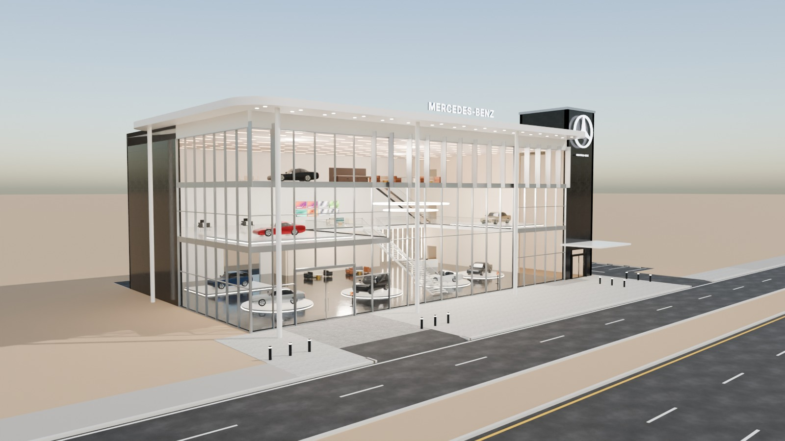
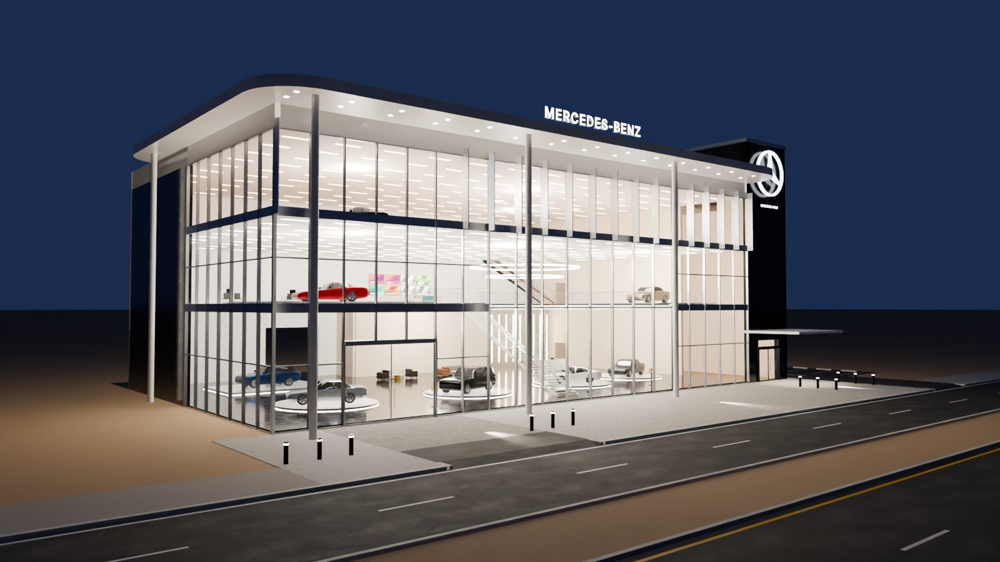
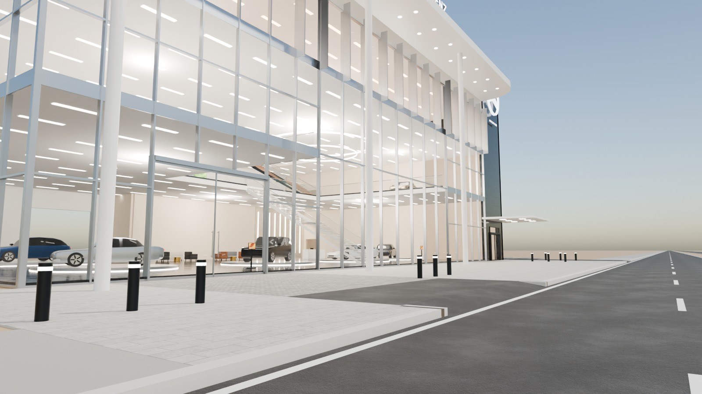
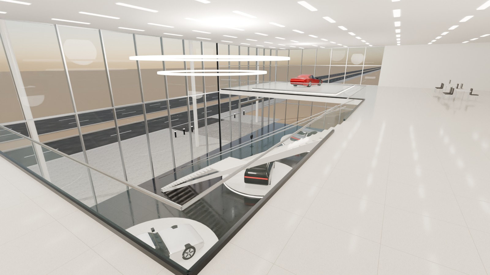

# 01 - Mercedes-Benz Flagship Showroom

*A - Luxury automotive showroom* - status: **complete**

Massing: 42 m glass box + 6 m dark-granite brand core rising to 20.6 m on the right; a floating white roof plate (rounded corners) hovers over the glass box on four slender portico columns.  Central double-height atrium (GF + L1) with a sculptural floating stair; L1 side galleries with display cars; L2 full-width lounge band with vertical fins. Separate entrances: 6 m sliding vehicle door (left) + customer entrance in the granite core under a blade canopy. Site: narrow 8 m display forecourt (vehicle crossing on the left), side driveway on the right to the rear service yard, optional side parking (11 bays) as a separate collection.

## Previews






## Key facts

| Item | Value |
|---|---|
| Storeys | 3 (floor levels [0.15, 6.6, 11.6] m, roof 16.2) |
| Frontage x depth x height | 48.0 x 28.0 x 20.9 m |
| LOD0 bounds (Blender) | [51.0, 33.0, 21.2] m |
| Setback from plot frontage | 8.0 m |
| Parking | optional side lot, 11 bays (OPTIONAL_PARKING) |
| Vehicle access | left vehicle crossing to forecourt/showroom door; right side driveway to rear service yard |
| Glass | PC_Glass alpha 0.16 curtain wall |
| Lights | {'INTERIOR_LIGHTING': 12, 'EXTERIOR_LIGHTING': 4} |
| Collision boxes | 6 |

## Files

- `mercedes_showroom.blend` - full editable Blender 4.5.15 LTS scene (textures referenced relatively from `textures/`).
- `mercedes_showroom.glb` - presentation export: LOD0/1/2 + site pieces + placeholder cars + lights + collision, textures embedded.
- `mercedes_showroom_building_only.glb` - identical but WITHOUT the `PLACEHOLDER_CARS` node.
- `lod/` - geometry-only per-LOD GLBs used for independent triangle read-back (+ placeholder cars GLB where present), `build_stats.json`.
- `textures/` - procedural PBR maps (JPEG albedo/ORM/normal) + PNG brand/screen graphics.
- `renders/` - four 1600x900 Cycles JPEGs + `render_report.json` (ray-traced visibility checks).
- `validation.json` - fresh-process validation results.

## Triangles (read from the exported GLB)

| LOD0 | LOD1 | LOD2 | Placeholder cars | Site pieces | Collision |
|---|---|---|---|---|---|
| 37538 | 9696 | 1609 | 17632 | 1176 | 72 |

LOD visibility ranges (glTF extras, applied by `../premium_lod_post_import.gd`): {'LOD0': [0.0, 90.0], 'LOD1': [90.0, 260.0], 'LOD2': [260.0, 1600.0]}; placeholder cars 0-340 m.

## Hierarchy

```
P01_<Title> (root, origin = centre of the plot frontage line, ground; front = -Y Blender / +Z glTF)
  LOD0/1/2 -> BUILDING_EXTERIOR, BUILDING_INTERIOR, GLASS_SYSTEM, FACADE_DETAILS, SIGNAGE, FURNITURE, DISPLAY_OBJECTS
  SIDEWALK_FRONTAGE, OPTIONAL_FORECOURT, DRIVEWAY, OPTIONAL_PARKING   (separate, removable site pieces)
  PLACEHOLDER_CARS (one object per car)   INTERIOR_LIGHTING   EXTERIOR_LIGHTING   COLLISION (*-convcolonly)
```

## Placeholder cars

Generic, badge-free silhouettes for replacement by the game's own vehicles. Each car is ONE object (pivot at ground centre, nose = local +X). Remove them all by deleting the `PLACEHOLDER_CARS` collection in Blender, by using `mercedes_showroom_building_only.glb`, or in Godot via the `premium_placeholder_cars` group.

| Object | Class | L x W x H (m) | Position (m) | Heading | Role | Tris |
|---|---|---|---|---|---|---|
| `P01_CAR_01_Sedan_CarPaintSilver` | sedan | 4.95 x 1.88 x 1.45 | [-17.0, 16.0, 0.31] | 160 | GF turntable | 2232 |
| `P01_CAR_02_Suv_CarPaintBlack` | suv | 4.95 x 1.96 x 1.76 | [-6.0, 15.5, 0.31] | 200 | GF atrium turntable | 2204 |
| `P01_CAR_03_Coupe_CarPaintWhite` | coupe | 4.55 x 1.92 x 1.29 | [4.5, 15.5, 0.31] | 160 | GF atrium turntable | 2176 |
| `P01_CAR_04_Sedan_CarPaintGraphite` | sedan | 4.95 x 1.88 x 1.45 | [12.8, 17.0, 0.31] | 200 | GF turntable | 2232 |
| `P01_CAR_05_Crossover_CarPaintBlue` | crossover | 4.6 x 1.88 x 1.62 | [-16.0, 27.8, 0.35] | 180 | GF rear plinth | 2204 |
| `P01_CAR_06_Coupe_CarPaintRed` | coupe | 4.55 x 1.92 x 1.29 | [-17.2, 15.2, 6.78] | 170 | L1 gallery plinth | 2176 |
| `P01_CAR_07_Sedan_CarPaintSand` | sedan | 4.95 x 1.88 x 1.45 | [13.2, 14.8, 6.78] | 190 | L1 gallery plinth | 2232 |
| `P01_CAR_08_Coupe_CarPaintBlack` | coupe | 4.55 x 1.92 x 1.29 | [-15.5, 15.5, 11.72] | 165 | L2 lounge turntable | 2176 |

## Validation

- Result: **PASS**; issues: []; warnings: []
- Degenerate faces: 4; inverted faces in watertight pieces: 0; vegetation: none
- Glass materials: {'PC_Glass': {'alpha': 0.16, 'blend': 'BLEND', 'double_sided': True}, 'PC_GlassBlue': {'alpha': 0.3, 'blend': 'BLEND', 'double_sided': True}, 'PC_GlassRail': {'alpha': 0.14, 'blend': 'BLEND', 'double_sided': True}, 'PC_GlassSatin': {'alpha': 0.55, 'blend': 'BLEND', 'double_sided': True}}
- GLB re-import into a clean scene: {'mesh_objects': 106, 'triangles': 67723, 'glb_triangles': 67723, 'images_loaded': 25, 'lights': 16, 'lod0_size_yup_converted': [51.0, 33.0, 21.2]}
- Ray-traced visibility from the road_view camera: cars readable 6/8 {'01_Sedan_CarPaintSilver': 0.67, '02_Suv_CarPaintBlack': 1.0, '03_Coupe_CarPaintWhite': 0.5, '04_Sedan_CarPaintGraphite': 0.67, '05_Crossover_CarPaintBlue': 1.0, '06_Coupe_CarPaintRed': 0.0, '07_Sedan_CarPaintSand': 0.67, '08_Coupe_CarPaintBlack': 0.0}; interior probes reached 1/5 {'GF_atrium': False, 'L1_gallery_left': False, 'L1_gallery_right': True, 'L2_lounge': False, 'L2_lounge_right': False}
- Ray-traced visibility from the day camera: cars readable 8/8 {'01_Sedan_CarPaintSilver': 0.67, '02_Suv_CarPaintBlack': 0.67, '03_Coupe_CarPaintWhite': 1.0, '04_Sedan_CarPaintGraphite': 1.0, '05_Crossover_CarPaintBlue': 0.83, '06_Coupe_CarPaintRed': 0.67, '07_Sedan_CarPaintSand': 0.83, '08_Coupe_CarPaintBlack': 0.33}; interior probes reached 5/5 {'GF_atrium': True, 'L1_gallery_left': True, 'L1_gallery_right': True, 'L2_lounge': True, 'L2_lounge_right': True}

Brand note: Rooftop "MERCEDES-BENZ" wordmark in a generic sans + simplified three-pointed star in a ring (geometric recreation, not official artwork).

Godot import has NOT been tested from the cloud session. If you copy this folder into a Godot project, delete or exclude the `.blend` (Godot would try to import it) - `textures/` and `renders/` contain `.gdignore`.
