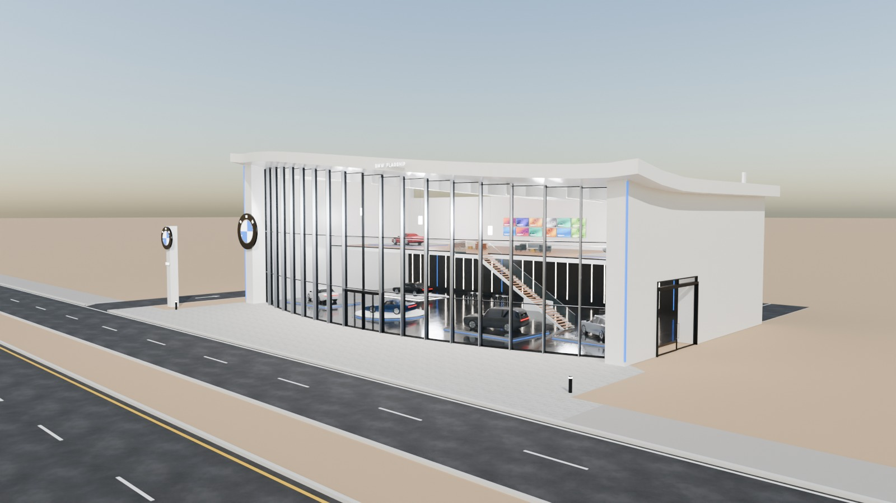
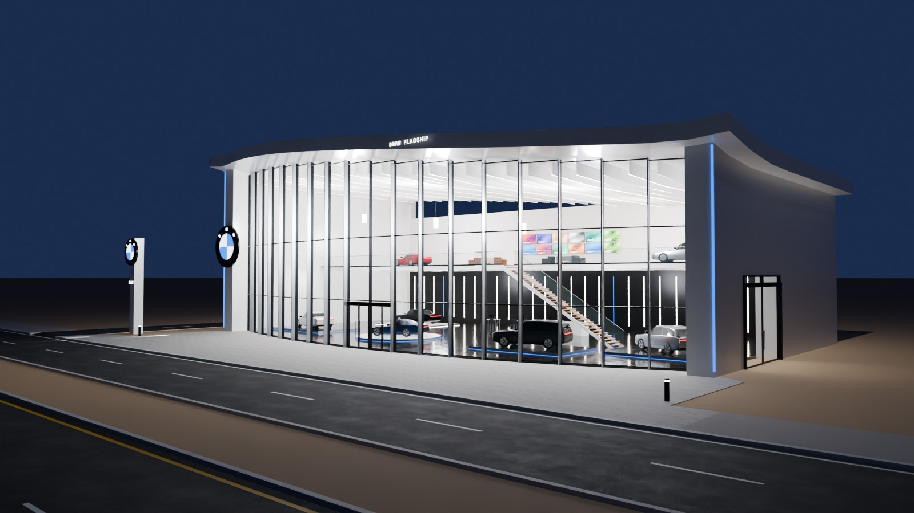
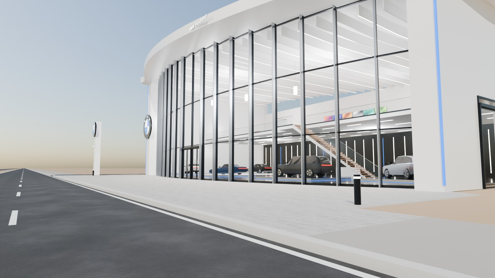
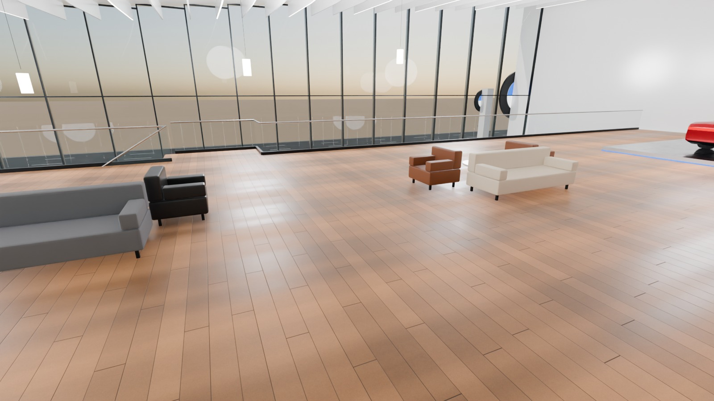

# 02 - BMW Flagship Showroom

*A - Luxury automotive showroom* - status: **complete**

Massing: a 42 m CONVEX curved glass front (plan arc, 4 m sagitta) held by a continuous white sculptural frame - two thick end blades plus a sweeping roof that rises from 10.9 m (right) to 14 m (left) and lifts at its front edge, with a blue LED line along the frame.  Interior: one tall open hall with radial white ceiling lamellas, five display positions on the ground floor and a rear mezzanine lounge (5.8 m) reached by a floating stair parallel to its edge. Separate glazed vehicle delivery door in the right blade; customer doors in the middle of the curve. Site: shallow curved forecourt directly off the pavement, LEFT side driveway to the rear, optional rear parking.

## Previews






## Key facts

| Item | Value |
|---|---|
| Storeys | 2 (floor levels [0.15, 5.8] m, roof sweeping 11.8-14.6 m) |
| Frontage x depth x height | 44.8 x 25.0 x 14.6 m |
| LOD0 bounds (Blender) | [49.65, 30.61, 16.14] m |
| Setback from plot frontage | 6.0 m |
| Parking | optional rear lot, 34 bays (OPTIONAL_PARKING) |
| Vehicle access | left side driveway from the service road to the rear yard; vehicle delivery door in the right blade |
| Glass | curved faceted curtain wall, PC_Glass alpha 0.16 |
| Lights | {'INTERIOR_LIGHTING': 7, 'EXTERIOR_LIGHTING': 2} |
| Collision boxes | 5 |

## Files

- `bmw_showroom.blend` - full editable Blender 4.5.15 LTS scene (textures referenced relatively from `textures/`).
- `bmw_showroom.glb` - presentation export: LOD0/1/2 + site pieces + placeholder cars + lights + collision, textures embedded.
- `bmw_showroom_building_only.glb` - identical but WITHOUT the `PLACEHOLDER_CARS` node.
- `lod/` - geometry-only per-LOD GLBs used for independent triangle read-back (+ placeholder cars GLB where present), `build_stats.json`.
- `textures/` - procedural PBR maps (JPEG albedo/ORM/normal) + PNG brand/screen graphics.
- `renders/` - four 1600x900 Cycles JPEGs + `render_report.json` (ray-traced visibility checks).
- `validation.json` - fresh-process validation results.

## Triangles (read from the exported GLB)

| LOD0 | LOD1 | LOD2 | Placeholder cars | Site pieces | Collision |
|---|---|---|---|---|---|
| 25424 | 7418 | 1302 | 15456 | 800 | 60 |

LOD visibility ranges (glTF extras, applied by `../premium_lod_post_import.gd`): {'LOD0': [0.0, 90.0], 'LOD1': [90.0, 260.0], 'LOD2': [260.0, 1600.0]}; placeholder cars 0-340 m.

## Hierarchy

```
P02_<Title> (root, origin = centre of the plot frontage line, ground; front = -Y Blender / +Z glTF)
  LOD0/1/2 -> BUILDING_EXTERIOR, BUILDING_INTERIOR, GLASS_SYSTEM, FACADE_DETAILS, SIGNAGE, FURNITURE, DISPLAY_OBJECTS
  SIDEWALK_FRONTAGE, OPTIONAL_FORECOURT, DRIVEWAY, OPTIONAL_PARKING   (separate, removable site pieces)
  PLACEHOLDER_CARS (one object per car)   INTERIOR_LIGHTING   EXTERIOR_LIGHTING   COLLISION (*-convcolonly)
```

## Placeholder cars

Generic, badge-free silhouettes for replacement by the game's own vehicles. Each car is ONE object (pivot at ground centre, nose = local +X). Remove them all by deleting the `PLACEHOLDER_CARS` collection in Blender, by using `bmw_showroom_building_only.glb`, or in Godot via the `premium_placeholder_cars` group.

| Object | Class | L x W x H (m) | Position (m) | Heading | Role | Tris |
|---|---|---|---|---|---|---|
| `P02_CAR_01_Coupe_CarPaintBlue` | coupe | 4.55 x 1.92 x 1.29 | [-4.0, 12.5, 0.33] | 200 | GF central turntable | 2176 |
| `P02_CAR_02_Sedan_CarPaintWhite` | sedan | 4.95 x 1.88 x 1.45 | [-15.5, 13.25, 0.35] | 165 | GF plinth left | 2232 |
| `P02_CAR_03_Suv_CarPaintGraphite` | suv | 4.95 x 1.96 x 1.76 | [9.0, 12.05, 0.35] | 195 | GF plinth | 2204 |
| `P02_CAR_04_Crossover_CarPaintSilver` | crossover | 4.6 x 1.88 x 1.62 | [16.9, 15.1, 0.35] | 150 | GF by delivery door | 2204 |
| `P02_CAR_05_Sedan_CarPaintBlack` | sedan | 4.95 x 1.88 x 1.45 | [-13.0, 23.75, 0.3] | 180 | GF under mezzanine | 2232 |
| `P02_CAR_06_Coupe_CarPaintRed` | coupe | 4.55 x 1.92 x 1.29 | [-14.75, 24.75, 5.95] | 170 | mezzanine plinth | 2176 |
| `P02_CAR_07_Sedan_CarPaintSilver` | sedan | 4.95 x 1.88 x 1.45 | [14.75, 23.25, 5.95] | 190 | mezzanine plinth | 2232 |

## Validation

- Result: **PASS**; issues: []; warnings: []
- Degenerate faces: 1; inverted faces in watertight pieces: 0; vegetation: none
- Glass materials: {'PC_Glass': {'alpha': 0.16, 'blend': 'BLEND', 'double_sided': True}, 'PC_GlassRail': {'alpha': 0.14, 'blend': 'BLEND', 'double_sided': True}}
- GLB re-import into a clean scene: {'mesh_objects': 74, 'triangles': 50460, 'glb_triangles': 50460, 'images_loaded': 16, 'lights': 9, 'lod0_size_yup_converted': [49.65, 30.61, 16.14]}
- Ray-traced visibility from the road_view camera: cars readable 5/7 {'01_Coupe_CarPaintBlue': 1.0, '02_Sedan_CarPaintWhite': 0.33, '03_Suv_CarPaintGraphite': 1.0, '04_Crossover_CarPaintSilver': 0.67, '05_Sedan_CarPaintBlack': 1.0, '06_Coupe_CarPaintRed': 0.0, '07_Sedan_CarPaintSilver': 0.0}; interior probes reached 1/4 {'GF_hall': False, 'GF_right': False, 'Mezzanine_left': True, 'Mezzanine_right': False}
- Ray-traced visibility from the day camera: cars readable 6/7 {'01_Coupe_CarPaintBlue': 0.67, '02_Sedan_CarPaintWhite': 0.33, '03_Suv_CarPaintGraphite': 0.67, '04_Crossover_CarPaintSilver': 0.67, '05_Sedan_CarPaintBlack': 0.67, '06_Coupe_CarPaintRed': 0.67, '07_Sedan_CarPaintSilver': 0.0}; interior probes reached 1/4 {'GF_hall': True, 'GF_right': False, 'Mezzanine_left': False, 'Mezzanine_right': False}

Brand note: Simplified roundel (black ring, blue/white quarters, generic letters) on blade + pylon; not official artwork.

Godot import has NOT been tested from the cloud session. If you copy this folder into a Godot project, delete or exclude the `.blend` (Godot would try to import it) - `textures/` and `renders/` contain `.gdignore`.
