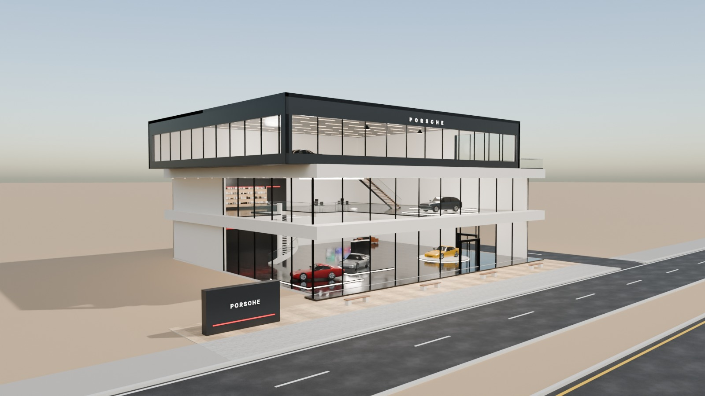
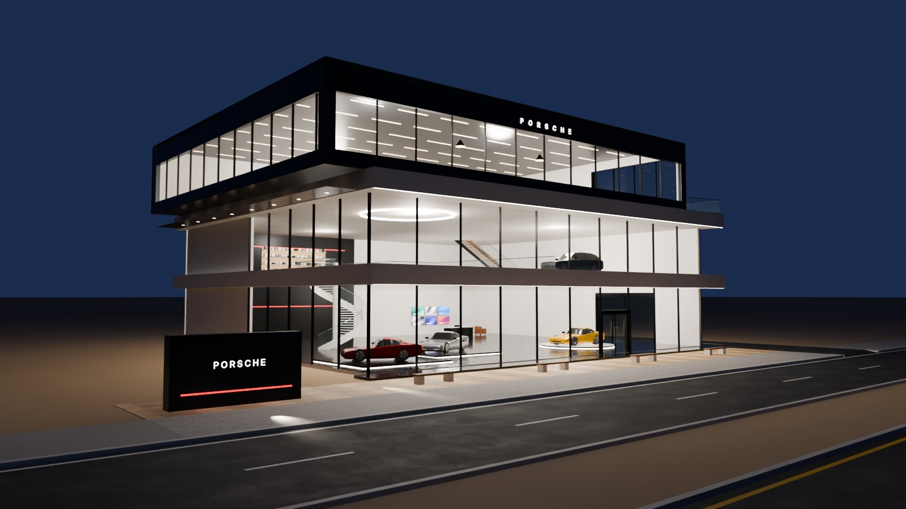
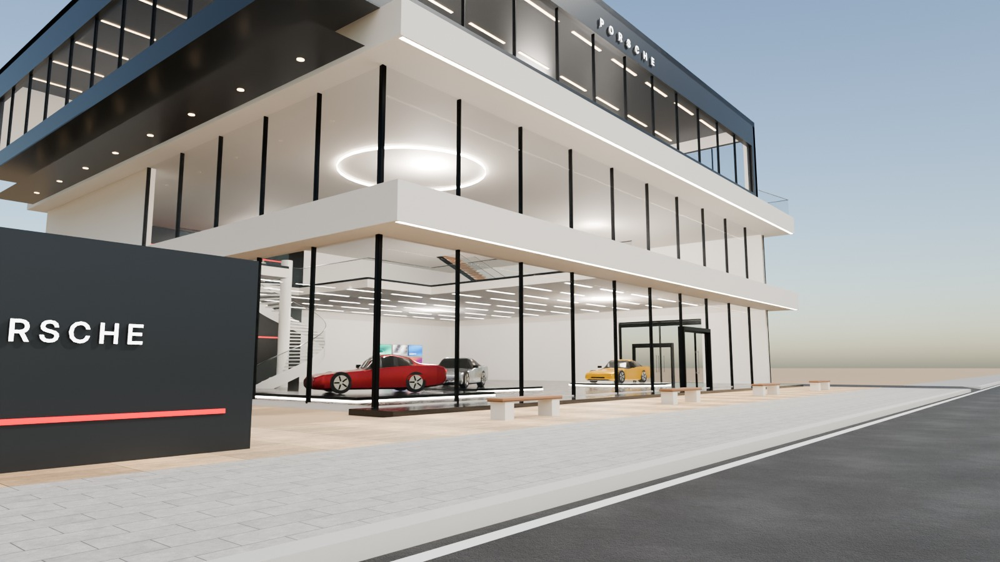
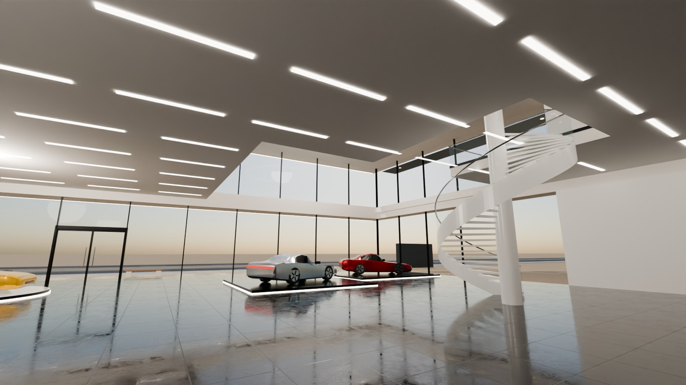

# 03 - Porsche Flagship Showroom

*A - Luxury automotive showroom* - status: **complete**

Massing: narrow (30 m) minimalist stack of deep white-concrete floor bands that project 1.6 m beyond a recessed, almost frameless glass skin -> strong horizontal lines (LED-washed underneath at night).  The third floor is a dark graphite box SHIFTED 3 m to the left (cantilevering past the building edge) with a continuous ribbon window, leaving a glass-railed terrace on the right.  Left half of GF+L1 is a double-height sports-car hall with a white sculptural spiral stair; L1 right gallery and L2 lounge also show cars. Site: direct pedestrian frontage (4 m setback, no parking), side driveway on the right to a vehicle door.

## Previews






## Key facts

| Item | Value |
|---|---|
| Storeys | 3 (floor levels [0.15, 5.4, 10.0] m, roof 14.6) |
| Frontage x depth x height | 33.0 x 28.0 x 15.2 m |
| LOD0 bounds (Blender) | [41.8, 31.45, 15.5] m |
| Setback from plot frontage | 4.0 m |
| Parking | none (direct pedestrian frontage) |
| Vehicle access | right side driveway from the service road to a glazed vehicle door; no front parking |
| Glass | frameless-look PC_GlassClear alpha 0.11 |
| Lights | {'INTERIOR_LIGHTING': 10, 'EXTERIOR_LIGHTING': 2} |
| Collision boxes | 3 |

## Files

- `porsche_showroom.blend` - full editable Blender 4.5.15 LTS scene (textures referenced relatively from `textures/`).
- `porsche_showroom.glb` - presentation export: LOD0/1/2 + site pieces + placeholder cars + lights + collision, textures embedded.
- `porsche_showroom_building_only.glb` - identical but WITHOUT the `PLACEHOLDER_CARS` node.
- `lod/` - geometry-only per-LOD GLBs used for independent triangle read-back (+ placeholder cars GLB where present), `build_stats.json`.
- `textures/` - procedural PBR maps (JPEG albedo/ORM/normal) + PNG brand/screen graphics.
- `renders/` - four 1600x900 Cycles JPEGs + `render_report.json` (ray-traced visibility checks).
- `validation.json` - fresh-process validation results.

## Triangles (read from the exported GLB)

| LOD0 | LOD1 | LOD2 | Placeholder cars | Site pieces | Collision |
|---|---|---|---|---|---|
| 21046 | 6326 | 1238 | 13084 | 632 | 36 |

LOD visibility ranges (glTF extras, applied by `../premium_lod_post_import.gd`): {'LOD0': [0.0, 90.0], 'LOD1': [90.0, 260.0], 'LOD2': [260.0, 1600.0]}; placeholder cars 0-340 m.

## Hierarchy

```
P03_<Title> (root, origin = centre of the plot frontage line, ground; front = -Y Blender / +Z glTF)
  LOD0/1/2 -> BUILDING_EXTERIOR, BUILDING_INTERIOR, GLASS_SYSTEM, FACADE_DETAILS, SIGNAGE, FURNITURE, DISPLAY_OBJECTS
  SIDEWALK_FRONTAGE, OPTIONAL_FORECOURT, DRIVEWAY, OPTIONAL_PARKING   (separate, removable site pieces)
  PLACEHOLDER_CARS (one object per car)   INTERIOR_LIGHTING   EXTERIOR_LIGHTING   COLLISION (*-convcolonly)
```

## Placeholder cars

Generic, badge-free silhouettes for replacement by the game's own vehicles. Each car is ONE object (pivot at ground centre, nose = local +X). Remove them all by deleting the `PLACEHOLDER_CARS` collection in Blender, by using `porsche_showroom_building_only.glb`, or in Godot via the `premium_placeholder_cars` group.

| Object | Class | L x W x H (m) | Position (m) | Heading | Role | Tris |
|---|---|---|---|---|---|---|
| `P03_CAR_01_Coupe_CarPaintRed` | coupe | 4.55 x 1.92 x 1.29 | [-11.0, 10.4, 0.27] | 155 | GF double-height hall | 2176 |
| `P03_CAR_02_Coupe_CarPaintSilver` | coupe | 4.55 x 1.92 x 1.29 | [-4.4, 12.9, 0.27] | 205 | GF double-height hall | 2176 |
| `P03_CAR_03_Coupe_CarPaintYellow` | coupe | 4.55 x 1.92 x 1.29 | [7.5, 11.5, 0.27] | 180 | GF turntable | 2176 |
| `P03_CAR_04_Crossover_CarPaintGraphite` | crossover | 4.6 x 1.88 x 1.62 | [5.65, 10.3, 5.52] | 170 | L1 gallery | 2204 |
| `P03_CAR_05_Coupe_CarPaintWhite` | coupe | 4.55 x 1.92 x 1.29 | [11.95, 15.3, 5.52] | 200 | L1 gallery | 2176 |
| `P03_CAR_06_Coupe_CarPaintBlack` | coupe | 4.55 x 1.92 x 1.29 | [-13.5, 9.8, 10.22] | 180 | L2 lounge (ribbon window) | 2176 |

## Validation

- Result: **PASS**; issues: []; warnings: []
- Degenerate faces: 1; inverted faces in watertight pieces: 0; vegetation: none
- Glass materials: {'PC_GlassClear': {'alpha': 0.11, 'blend': 'BLEND', 'double_sided': True}, 'PC_GlassRail': {'alpha': 0.14, 'blend': 'BLEND', 'double_sided': True}}
- GLB re-import into a clean scene: {'mesh_objects': 118, 'triangles': 42362, 'glb_triangles': 42362, 'images_loaded': 28, 'lights': 12, 'lod0_size_yup_converted': [41.8, 31.45, 15.5]}
- Ray-traced visibility from the road_view camera: cars readable 3/6 {'01_Coupe_CarPaintRed': 0.67, '02_Coupe_CarPaintSilver': 0.5, '03_Coupe_CarPaintYellow': 1.0, '04_Crossover_CarPaintGraphite': 0.0, '05_Coupe_CarPaintWhite': 0.0, '06_Coupe_CarPaintBlack': 0.0}; interior probes reached 1/4 {'GF_hall': False, 'GF_right': True, 'L1_gallery': False, 'L2_lounge': False}
- Ray-traced visibility from the day camera: cars readable 5/6 {'01_Coupe_CarPaintRed': 1.0, '02_Coupe_CarPaintSilver': 1.0, '03_Coupe_CarPaintYellow': 1.0, '04_Crossover_CarPaintGraphite': 0.67, '05_Coupe_CarPaintWhite': 0.0, '06_Coupe_CarPaintBlack': 0.33}; interior probes reached 3/4 {'GF_hall': True, 'GF_right': True, 'L1_gallery': False, 'L2_lounge': True}

Brand note: Spaced "PORSCHE" wordmark in a generic sans; the crest is NOT reproduced.

Godot import has NOT been tested from the cloud session. If you copy this folder into a Godot project, delete or exclude the `.blend` (Godot would try to import it) - `textures/` and `renders/` contain `.gdignore`.

## Brand signage correction

The brand identity was corrected on branch `claude/flagship-brand-fixes-boulevard-5`, and only the signage changed. Official PORSCHE wordmark on the upper box fascia (7.5 m); coloured crest (1.22 m) + wordmark (3.5 m) on the forecourt monolith. Artwork: Wordmark: Porsche Design System (official vector). Crest: simple-icons line-art coloured from the official 2023 crest image (recreation). Old signage: `BRAND_SIGNAGE_ORIGINAL_DISABLED` collection in the .blend (not exported). New signage: `BRAND_SIGNAGE_CORRECTED` (+ `LOD1_` / `LOD2_`). Renders: `renders/porsche_showroom_signage_*.jpg`. Validation: `brand_signage_correction.json` (PASS). Provenance and permissions: `../FLAGSHIP_BRANDING_CORRECTION/BRAND_ASSET_SOURCES.md`. Internal test asset; no endorsement implied.
