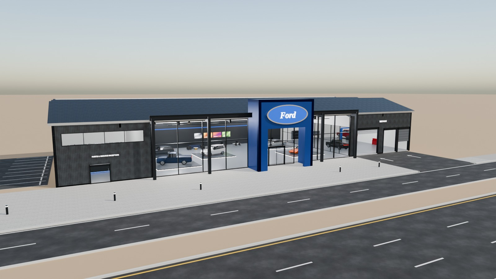
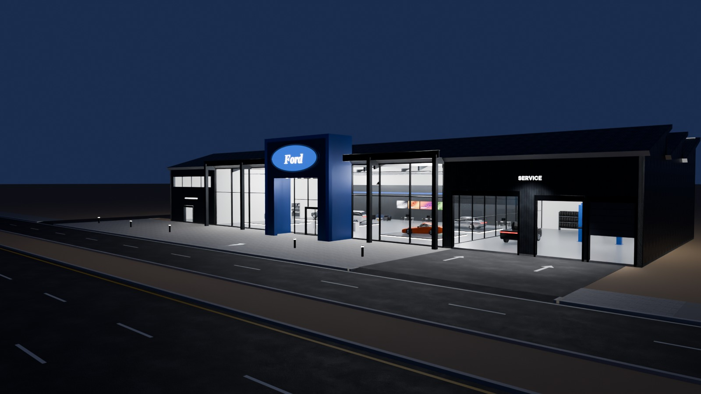
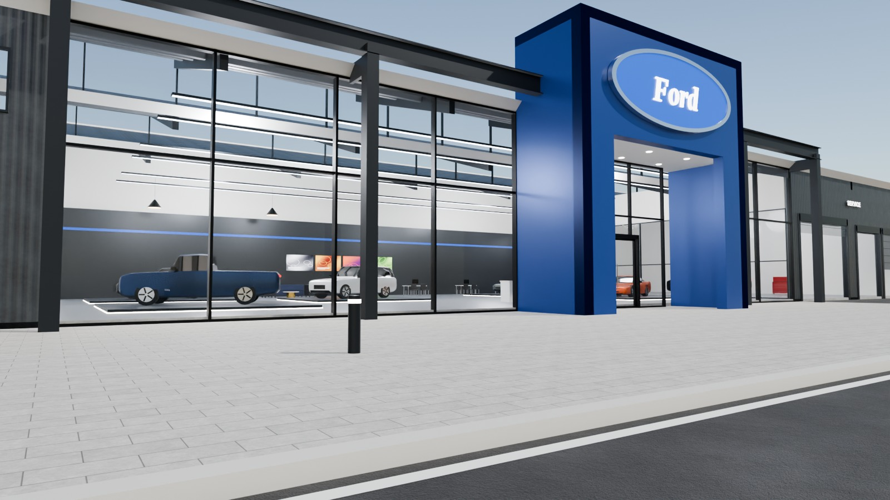
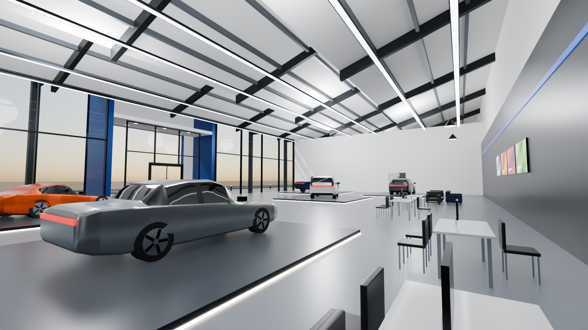

# 04 - Ford Showroom

*A - Luxury automotive showroom* - status: **complete**

Massing: a 64 m wide, low (7.8 m) industrial clear-span hall with an exposed dark-steel portal frame in front of a 36 m display glazing, a SAWTOOTH north-light roof (three teeth rising to 10.3 m) and a projecting blue entrance portal (10.8 m) carrying the oval sign.  Dark profiled-metal end blocks: parts/service reception on the left, vehicle delivery bay + two service roller doors on the right (service zone visible through a glass partition). Site: wide paved forecourt, a direct service apron for the right zone, optional left-side customer parking.

## Previews






## Key facts

| Item | Value |
|---|---|
| Storeys | 1 (floor levels [0.15] m, roof sawtooth, eaves 7.8 m, ridges 10.3 m, portal 10.8 m) |
| Frontage x depth x height | 64.0 x 24.0 x 10.8 m |
| LOD0 bounds (Blender) | [64.8, 27.74, 11.1] m |
| Setback from plot frontage | 10.0 m |
| Parking | optional left-side customer lot, 9 bays + access aisle (OPTIONAL_PARKING) |
| Vehicle access | direct service apron from the service road to delivery bay + 2 service doors; separate parking crossing on the left |
| Glass | 36 m display glazing PC_Glass alpha 0.16 + north lights |
| Lights | {'INTERIOR_LIGHTING': 7, 'EXTERIOR_LIGHTING': 2} |
| Collision boxes | 6 |

## Files

- `ford_showroom.blend` - full editable Blender 4.5.15 LTS scene (textures referenced relatively from `textures/`).
- `ford_showroom.glb` - presentation export: LOD0/1/2 + site pieces + placeholder cars + lights + collision, textures embedded.
- `ford_showroom_building_only.glb` - identical but WITHOUT the `PLACEHOLDER_CARS` node.
- `lod/` - geometry-only per-LOD GLBs used for independent triangle read-back (+ placeholder cars GLB where present), `build_stats.json`.
- `textures/` - procedural PBR maps (JPEG albedo/ORM/normal) + PNG brand/screen graphics.
- `renders/` - four 1600x900 Cycles JPEGs + `render_report.json` (ray-traced visibility checks).
- `validation.json` - fresh-process validation results.

## Triangles (read from the exported GLB)

| LOD0 | LOD1 | LOD2 | Placeholder cars | Site pieces | Collision |
|---|---|---|---|---|---|
| 20922 | 7590 | 1857 | 15428 | 652 | 72 |

LOD visibility ranges (glTF extras, applied by `../premium_lod_post_import.gd`): {'LOD0': [0.0, 90.0], 'LOD1': [90.0, 260.0], 'LOD2': [260.0, 1600.0]}; placeholder cars 0-340 m.

## Hierarchy

```
P04_<Title> (root, origin = centre of the plot frontage line, ground; front = -Y Blender / +Z glTF)
  LOD0/1/2 -> BUILDING_EXTERIOR, BUILDING_INTERIOR, GLASS_SYSTEM, FACADE_DETAILS, SIGNAGE, FURNITURE, DISPLAY_OBJECTS
  SIDEWALK_FRONTAGE, OPTIONAL_FORECOURT, DRIVEWAY, OPTIONAL_PARKING   (separate, removable site pieces)
  PLACEHOLDER_CARS (one object per car)   INTERIOR_LIGHTING   EXTERIOR_LIGHTING   COLLISION (*-convcolonly)
```

## Placeholder cars

Generic, badge-free silhouettes for replacement by the game's own vehicles. Each car is ONE object (pivot at ground centre, nose = local +X). Remove them all by deleting the `PLACEHOLDER_CARS` collection in Blender, by using `ford_showroom_building_only.glb`, or in Godot via the `premium_placeholder_cars` group.

| Object | Class | L x W x H (m) | Position (m) | Heading | Role | Tris |
|---|---|---|---|---|---|---|
| `P04_CAR_01_Pickup_CarPaintBlue` | pickup | 5.6 x 2.0 x 1.92 | [-15.0, 16.75, 0.27] | 160 | display platform | 2204 |
| `P04_CAR_02_Suv_CarPaintWhite` | suv | 4.95 x 1.96 x 1.76 | [-6.25, 22.0, 0.27] | 200 | display platform | 2204 |
| `P04_CAR_03_Coupe_CarPaintOrange` | coupe | 4.55 x 1.92 x 1.29 | [9.5, 16.75, 0.27] | 200 | display platform | 2176 |
| `P04_CAR_04_Crossover_CarPaintGraphite` | crossover | 4.6 x 1.88 x 1.62 | [-15.0, 26.5, 0.27] | 180 | display platform | 2204 |
| `P04_CAR_05_Sedan_CarPaintSilver` | sedan | 4.95 x 1.88 x 1.45 | [9.5, 26.0, 0.27] | 180 | display platform | 2232 |
| `P04_CAR_06_Pickup_CarPaintBlack` | pickup | 5.6 x 2.0 x 1.92 | [20.0, 18.0, 0.15] | 90 | vehicle delivery bay | 2204 |
| `P04_CAR_07_Suv_CarPaintRed` | suv | 4.95 x 1.96 x 1.76 | [26.0, 22.0, 1.7] | 90 | service lift (raised) | 2204 |

## Validation

- Result: **PASS**; issues: []; warnings: []
- Degenerate faces: 6; inverted faces in watertight pieces: 0; vegetation: none
- Glass materials: {'PC_Glass': {'alpha': 0.16, 'blend': 'BLEND', 'double_sided': True}, 'PC_GlassBlue': {'alpha': 0.3, 'blend': 'BLEND', 'double_sided': True}, 'PC_GlassClear': {'alpha': 0.11, 'blend': 'BLEND', 'double_sided': True}}
- GLB re-import into a clean scene: {'mesh_objects': 88, 'triangles': 46521, 'glb_triangles': 46521, 'images_loaded': 16, 'lights': 9, 'lod0_size_yup_converted': [64.8, 27.74, 11.1]}
- Ray-traced visibility from the road_view camera: cars readable 3/7 {'01_Pickup_CarPaintBlue': 1.0, '02_Suv_CarPaintWhite': 0.33, '03_Coupe_CarPaintOrange': 0.67, '04_Crossover_CarPaintGraphite': 0.0, '05_Sedan_CarPaintSilver': 0.17, '06_Pickup_CarPaintBlack': 0.0, '07_Suv_CarPaintRed': 0.0}; interior probes reached 0/3 {'Hall_left': False, 'Hall_right': False, 'Reception': False}
- Ray-traced visibility from the day camera: cars readable 7/7 {'01_Pickup_CarPaintBlue': 1.0, '02_Suv_CarPaintWhite': 1.0, '03_Coupe_CarPaintOrange': 0.33, '04_Crossover_CarPaintGraphite': 0.67, '05_Sedan_CarPaintSilver': 0.5, '06_Pickup_CarPaintBlack': 0.5, '07_Suv_CarPaintRed': 0.33}; interior probes reached 1/3 {'Hall_left': False, 'Hall_right': True, 'Reception': False}

Brand note: Generic blue oval with "Ford" in Liberation Serif Bold Italic (the official script lettering is not reproduced).

Godot import has NOT been tested from the cloud session. If you copy this folder into a Godot project, delete or exclude the `.blend` (Godot would try to import it) - `textures/` and `renders/` contain `.gdignore`.

## Brand signage correction

The brand identity was corrected on branch `claude/flagship-brand-fixes-boulevard-5`, and only the signage changed. Blue Oval (7.4 x 2.78 m) with raised white script and rim on the portal; supporting SERVICE / PARTS texts re-set in Inter. Artwork: ford.com navigation logo SVG (official vector, #00095B). Old signage: `BRAND_SIGNAGE_ORIGINAL_DISABLED` collection in the .blend (not exported). New signage: `BRAND_SIGNAGE_CORRECTED` (+ `LOD1_` / `LOD2_`). Renders: `renders/ford_showroom_signage_*.jpg`. Validation: `brand_signage_correction.json` (PASS). Provenance and permissions: `../FLAGSHIP_BRANDING_CORRECTION/BRAND_ASSET_SOURCES.md`. Internal test asset; no endorsement implied.
