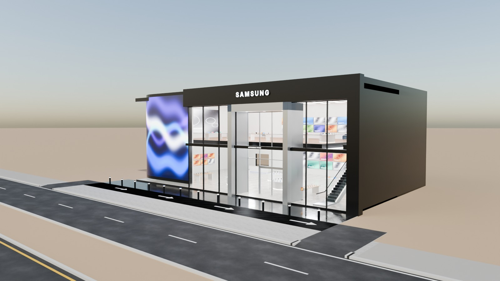
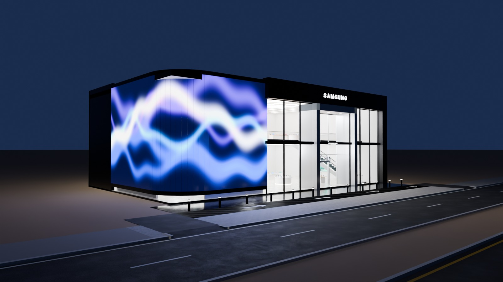
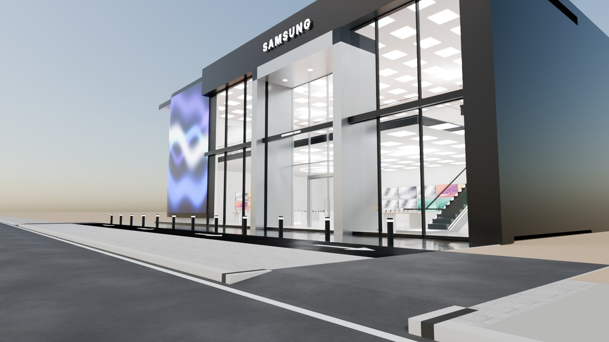
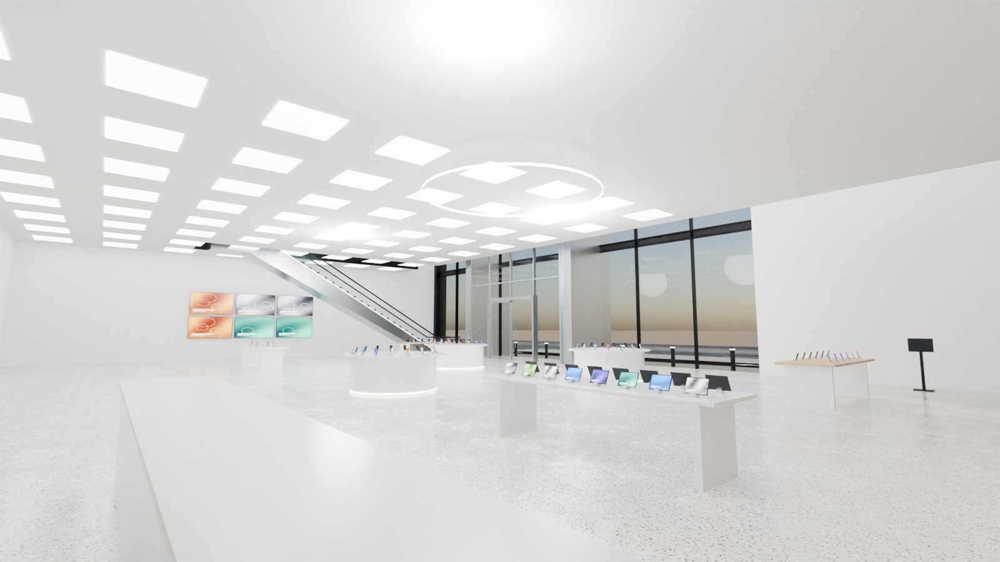

# 05 - Samsung Flagship Experience Store

*B - Technology flagship* - status: **complete**

Massing: a black-metal framed box whose LEFT corner is wrapped by a curved 11 m tall LED media wall (rounded corner, radius 4 m); the right two thirds are a two-storey glass exhibition front split by a slim black floor band, with a grand recessed full-height entrance portal in brushed silver.  Upper floor is set back 3 m from the glass so both levels read through the facade; an escalator links the floors. Site: shallow pedestrian forecourt with a short drop-off lay-by (service-road side), no dedicated parking.

## Previews






## Key facts

| Item | Value |
|---|---|
| Storeys | 2 (floor levels [0.15, 6.0] m, roof 12.0) |
| Frontage x depth x height | 35.2 x 22.6 x 12.6 m |
| LOD0 bounds (Blender) | [34.68, 22.75, 12.9] m |
| Setback from plot frontage | 7.0 m |
| Parking | none - short drop-off lay-by in OPTIONAL_FORECOURT |
| Vehicle access | in/out crossings to a 2.8 m drop-off lay-by along the frontage (service road side) |
| Glass | two-storey PC_Glass front + recessed entrance portal |
| Lights | {'INTERIOR_LIGHTING': 6, 'EXTERIOR_LIGHTING': 2} |
| Collision boxes | 2 |

## Files

- `samsung_flagship.blend` - full editable Blender 4.5.15 LTS scene (textures referenced relatively from `textures/`).
- `samsung_flagship.glb` - presentation export: LOD0/1/2 + site pieces + placeholder cars + lights + collision, textures embedded.
- (no placeholder cars in this asset, so the main GLB is already building-only)
- `lod/` - geometry-only per-LOD GLBs used for independent triangle read-back (+ placeholder cars GLB where present), `build_stats.json`.
- `textures/` - procedural PBR maps (JPEG albedo/ORM/normal) + PNG brand/screen graphics.
- `renders/` - four 1600x900 Cycles JPEGs + `render_report.json` (ray-traced visibility checks).
- `validation.json` - fresh-process validation results.

## Triangles (read from the exported GLB)

| LOD0 | LOD1 | LOD2 | Placeholder cars | Site pieces | Collision |
|---|---|---|---|---|---|
| 13208 | 4736 | 1039 | 0 | 1008 | 24 |

LOD visibility ranges (glTF extras, applied by `../premium_lod_post_import.gd`): {'LOD0': [0.0, 90.0], 'LOD1': [90.0, 260.0], 'LOD2': [260.0, 1600.0]}; placeholder cars 0-340 m.

## Hierarchy

```
P05_<Title> (root, origin = centre of the plot frontage line, ground; front = -Y Blender / +Z glTF)
  LOD0/1/2 -> BUILDING_EXTERIOR, BUILDING_INTERIOR, GLASS_SYSTEM, FACADE_DETAILS, SIGNAGE, FURNITURE, DISPLAY_OBJECTS
  SIDEWALK_FRONTAGE, OPTIONAL_FORECOURT, DRIVEWAY, OPTIONAL_PARKING   (separate, removable site pieces)
  PLACEHOLDER_CARS (one object per car)   INTERIOR_LIGHTING   EXTERIOR_LIGHTING   COLLISION (*-convcolonly)
```

## Validation

- Result: **PASS**; issues: []; warnings: []
- Degenerate faces: 0; inverted faces in watertight pieces: 0; vegetation: none
- Glass materials: {'PC_Glass': {'alpha': 0.16, 'blend': 'BLEND', 'double_sided': True}, 'PC_GlassRail': {'alpha': 0.14, 'blend': 'BLEND', 'double_sided': True}}
- GLB re-import into a clean scene: {'mesh_objects': 70, 'triangles': 20015, 'glb_triangles': 20015, 'images_loaded': 25, 'lights': 8, 'lod0_size_yup_converted': [34.68, 22.75, 12.9]}
- Ray-traced visibility from the road_view camera: cars readable 0/0 {}; interior probes reached 1/4 {'GF_islands': False, 'GF_tvwall': True, 'L1_tables': False, 'L1_tvwall': False}
- Ray-traced visibility from the day camera: cars readable 0/0 {}; interior probes reached 2/4 {'GF_islands': False, 'GF_tvwall': True, 'L1_tables': False, 'L1_tvwall': True}

Brand note: "SAMSUNG" in Inter ExtraBold (not the official typeface); LED media wall shows abstract generated content.

Godot import has NOT been tested from the cloud session. If you copy this folder into a Godot project, delete or exclude the `.blend` (Godot would try to import it) - `textures/` and `renders/` contain `.gdignore`.
