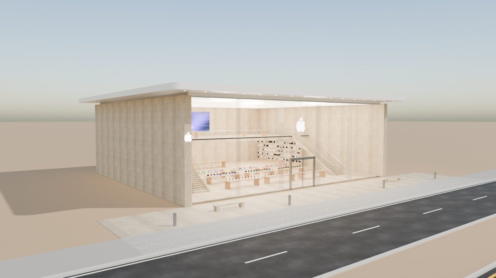
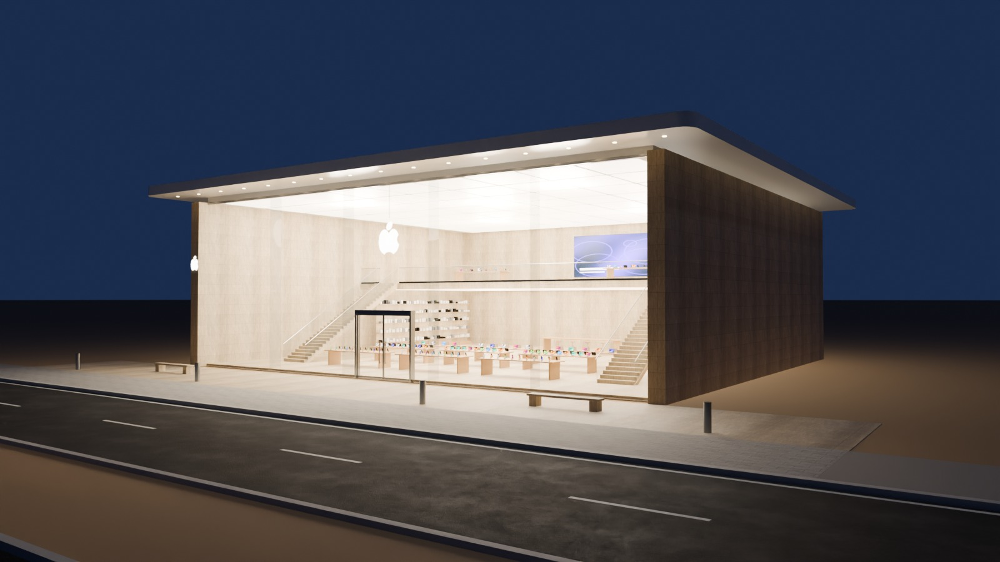
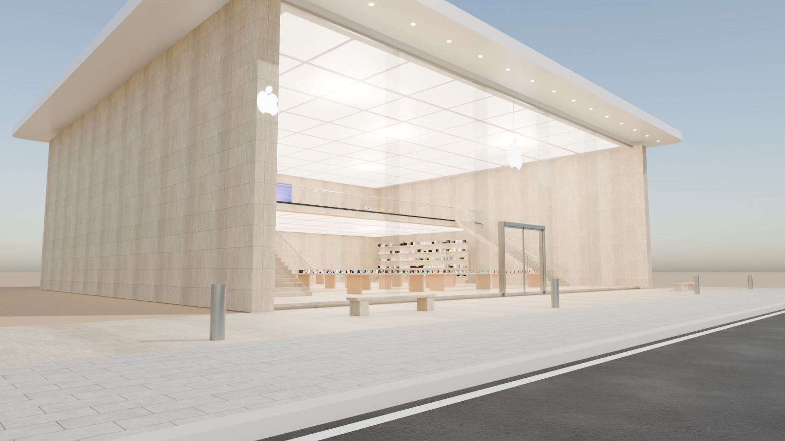
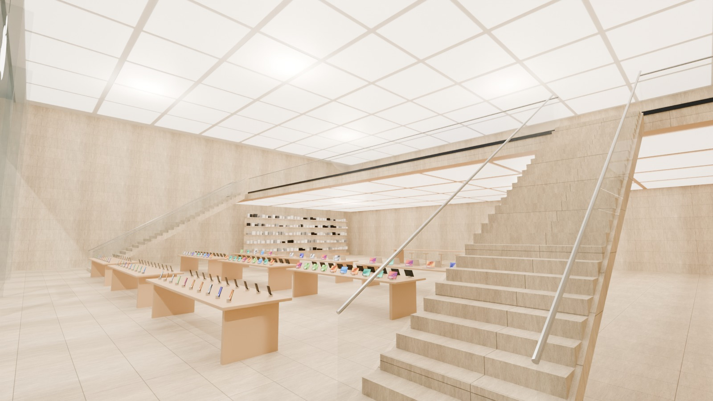

# 06 - Apple Flagship Store

*B - Technology flagship* - status: **complete**

Massing: pure minimalist pavilion - five 5.6 m x 9.4 m frameless glass panes stabilised by internal glass fins, held between two thick travertine flank walls and capped by a razor-thin white roof plate cantilevering 2.5 m on all sides. Inside: a 9.4 m double-height hall under a luminous backlit ceiling, rows of light-oak product tables (iPhone, Mac, iPad zones), twin stone stairs with glass balustrades rising to a rear mezzanine with more tables and a video wall. Site: open stone plaza directly off the pavement (pedestrian only, no parking, no vehicle access).

## Previews






## Key facts

| Item | Value |
|---|---|
| Storeys | 2 (floor levels [0.15, 5.0] m, roof 10.45) |
| Frontage x depth x height | 33.0 x 31.0 x 10.45 m |
| LOD0 bounds (Blender) | [33.0, 30.5, 10.75] m |
| Setback from plot frontage | 5.4 m |
| Parking | none (pedestrian plaza only) |
| Vehicle access | pedestrian only - no vehicle access |
| Glass | frameless PC_GlassClear alpha 0.11 with glass fins |
| Lights | {'INTERIOR_LIGHTING': 7, 'EXTERIOR_LIGHTING': 1} |
| Collision boxes | 2 |

## Files

- `apple_flagship.blend` - full editable Blender 4.5.15 LTS scene (textures referenced relatively from `textures/`).
- `apple_flagship.glb` - presentation export: LOD0/1/2 + site pieces + placeholder cars + lights + collision, textures embedded.
- (no placeholder cars in this asset, so the main GLB is already building-only)
- `lod/` - geometry-only per-LOD GLBs used for independent triangle read-back (+ placeholder cars GLB where present), `build_stats.json`.
- `textures/` - procedural PBR maps (JPEG albedo/ORM/normal) + PNG brand/screen graphics.
- `renders/` - four 1600x900 Cycles JPEGs + `render_report.json` (ray-traced visibility checks).
- `validation.json` - fresh-process validation results.

## Triangles (read from the exported GLB)

| LOD0 | LOD1 | LOD2 | Placeholder cars | Site pieces | Collision |
|---|---|---|---|---|---|
| 15036 | 3596 | 508 | 0 | 476 | 24 |

LOD visibility ranges (glTF extras, applied by `../premium_lod_post_import.gd`): {'LOD0': [0.0, 90.0], 'LOD1': [90.0, 260.0], 'LOD2': [260.0, 1600.0]}; placeholder cars 0-340 m.

## Hierarchy

```
P06_<Title> (root, origin = centre of the plot frontage line, ground; front = -Y Blender / +Z glTF)
  LOD0/1/2 -> BUILDING_EXTERIOR, BUILDING_INTERIOR, GLASS_SYSTEM, FACADE_DETAILS, SIGNAGE, FURNITURE, DISPLAY_OBJECTS
  SIDEWALK_FRONTAGE, OPTIONAL_FORECOURT, DRIVEWAY, OPTIONAL_PARKING   (separate, removable site pieces)
  PLACEHOLDER_CARS (one object per car)   INTERIOR_LIGHTING   EXTERIOR_LIGHTING   COLLISION (*-convcolonly)
```

## Validation

- Result: **PASS**; issues: []; warnings: []
- Degenerate faces: 2; inverted faces in watertight pieces: 0; vegetation: none
- Glass materials: {'PC_GlassClear': {'alpha': 0.11, 'blend': 'BLEND', 'double_sided': True}, 'PC_GlassRail': {'alpha': 0.14, 'blend': 'BLEND', 'double_sided': True}}
- GLB re-import into a clean scene: {'mesh_objects': 65, 'triangles': 19640, 'glb_triangles': 19640, 'images_loaded': 14, 'lights': 8, 'lod0_size_yup_converted': [33.0, 30.5, 10.75]}
- Ray-traced visibility from the road_view camera: cars readable 0/0 {}; interior probes reached 2/4 {'Hall_tables': True, 'Hall_tables_2': False, 'Mezzanine': False, 'Mezzanine_r': True}
- Ray-traced visibility from the day camera: cars readable 0/0 {}; interior probes reached 3/4 {'Hall_tables': True, 'Hall_tables_2': True, 'Mezzanine': False, 'Mezzanine_r': True}

Brand note: Apple-style silhouette drawn procedurally from circles (simplified, not official artwork); no "iPhone Store" naming.

Godot import has NOT been tested from the cloud session. If you copy this folder into a Godot project, delete or exclude the `.blend` (Godot would try to import it) - `textures/` and `renders/` contain `.gdignore`.
