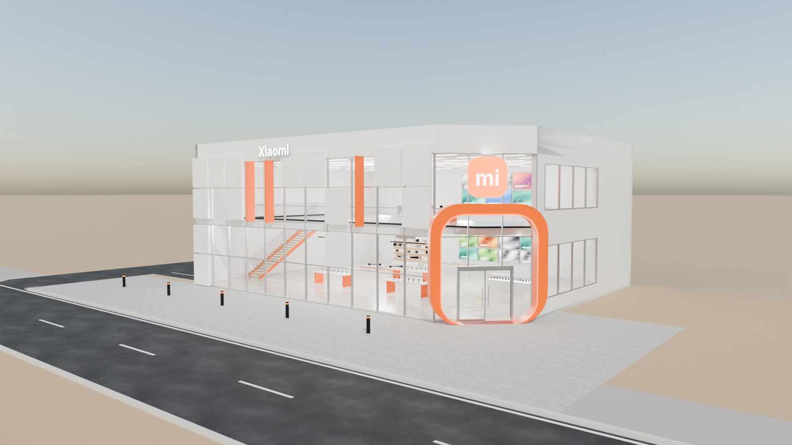
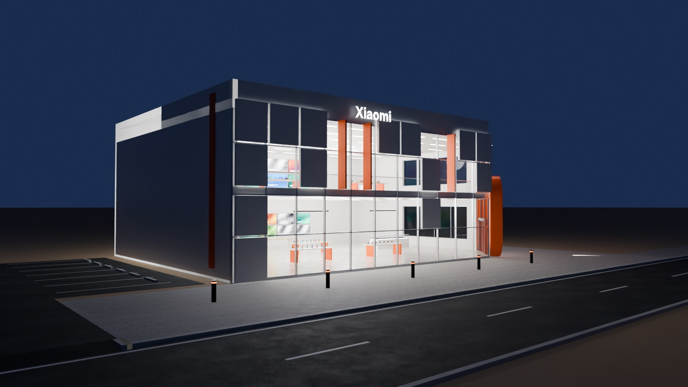
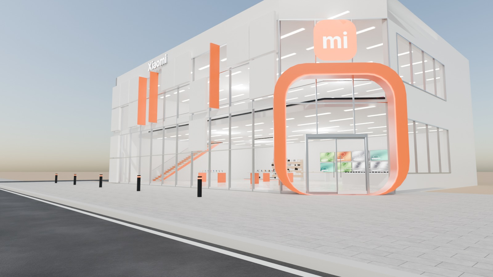
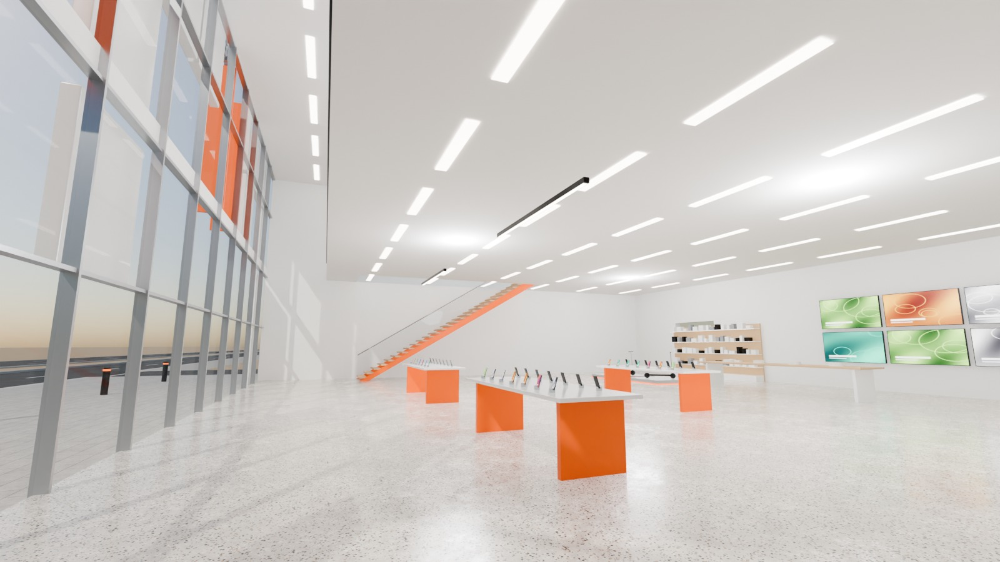

# 07 - Xiaomi Flagship Store

*B - Technology flagship* - status: **incomplete**

Massing: compact two-storey box with a CHAMFERED right corner holding the entrance inside a big orange rounded-square portal (echoing the badge shape).  The front is a full-height glass wall overlaid by a staggered grid of proud white modular panels (~35 % cover) and slim orange fins, so the facade reads as a pixel pattern while most of the glass stays transparent.  Inside: phone islands, a TV wall, smart-home and wearables zones, e-scooters, an orange stair to an upper retail floor set back 2.5 m from the glass. Site: corner plaza at the entrance + optional small side car park on the left (separate collection).

## Previews






## Key facts

| Item | Value |
|---|---|
| Storeys | 2 (floor levels [0.15, 5.0] m, roof 9.6) |
| Frontage x depth x height | 26.0 x 20.0 x 10.6 m |
| LOD0 bounds (Blender) | - m |
| Setback from plot frontage | 5.0 m |
| Parking | optional left side car park, 6 bays (OPTIONAL_PARKING) |
| Vehicle access | left crossing to the small side car park; corner pedestrian plaza |
| Glass | full-height PC_Glass behind ~35 % modular panel cover |
| Lights | None |
| Collision boxes | None |

## Files

- `xiaomi_flagship.blend` - full editable Blender 4.5.15 LTS scene (textures referenced relatively from `textures/`).
- `xiaomi_flagship.glb` - presentation export: LOD0/1/2 + site pieces + placeholder cars + lights + collision, textures embedded.
- (no placeholder cars in this asset, so the main GLB is already building-only)
- `lod/` - geometry-only per-LOD GLBs used for independent triangle read-back (+ placeholder cars GLB where present), `build_stats.json`.
- `textures/` - procedural PBR maps (JPEG albedo/ORM/normal) + PNG brand/screen graphics.
- `renders/` - four 1600x900 Cycles JPEGs + `render_report.json` (ray-traced visibility checks).
- `validation.json` - fresh-process validation results.

## Triangles (read from the exported GLB)

| LOD0 | LOD1 | LOD2 | Placeholder cars | Site pieces | Collision |
|---|---|---|---|---|---|
| None | None | None | 0 | 0 | None |

LOD visibility ranges (glTF extras, applied by `../premium_lod_post_import.gd`): {}; placeholder cars 0-340 m.

## Hierarchy

```
P07_<Title> (root, origin = centre of the plot frontage line, ground; front = -Y Blender / +Z glTF)
  LOD0/1/2 -> BUILDING_EXTERIOR, BUILDING_INTERIOR, GLASS_SYSTEM, FACADE_DETAILS, SIGNAGE, FURNITURE, DISPLAY_OBJECTS
  SIDEWALK_FRONTAGE, OPTIONAL_FORECOURT, DRIVEWAY, OPTIONAL_PARKING   (separate, removable site pieces)
  PLACEHOLDER_CARS (one object per car)   INTERIOR_LIGHTING   EXTERIOR_LIGHTING   COLLISION (*-convcolonly)
```

## Validation

- Result: **FAIL**; issues: None; warnings: None
- Degenerate faces: None; inverted faces in watertight pieces: None; vegetation: none
- Glass materials: None
- GLB re-import into a clean scene: None

Brand note: Orange rounded-square badge with "mi" in Inter Bold + "Xiaomi" wordmark (simplified recreation).

Godot import has NOT been tested from the cloud session. If you copy this folder into a Godot project, delete or exclude the `.blend` (Godot would try to import it) - `textures/` and `renders/` contain `.gdignore`.
