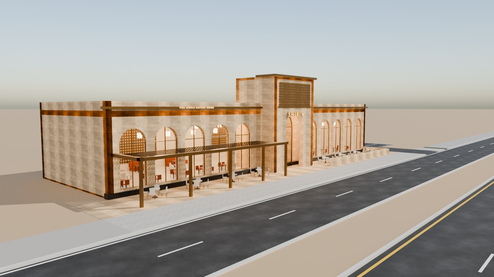
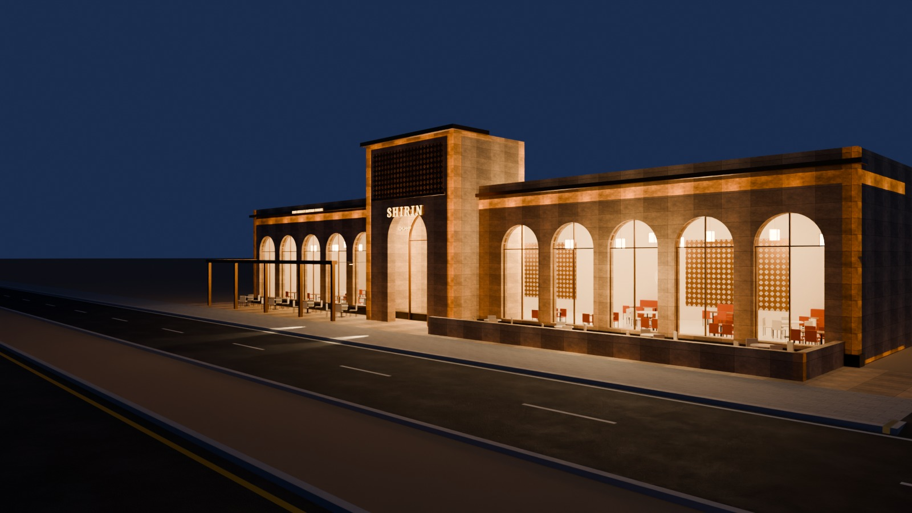
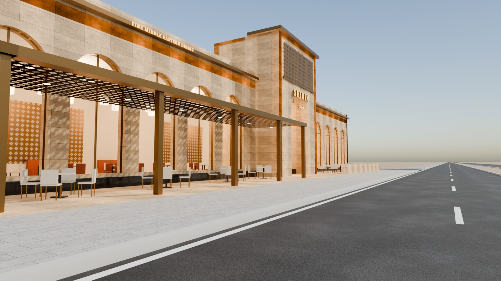
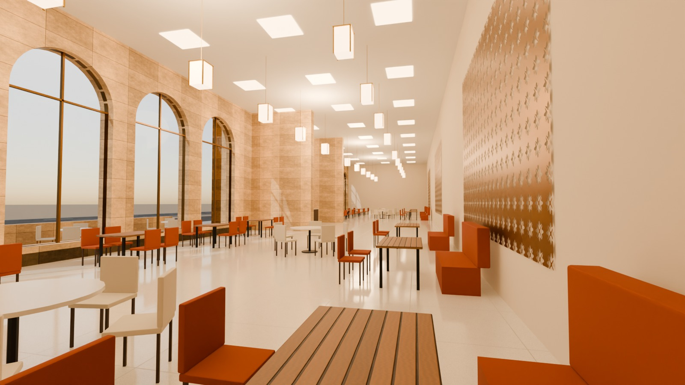

# 08 - Shirin Restaurant

*C - Long-frontage restaurant* - status: **complete**

Massing: a long (46 m) but SHALLOW (14 m) sand-limestone frontage with ten tall arched windows and a bronze cornice, broken in the middle by an 11 m entrance tower carrying a tall pointed-arch portal and a back-lit bronze mashrabiya screen.  A 4.6 m deep terrace runs along the pavement: shaded on the left by a bronze pergola with lattice screens, open with a low stone balustrade on the right.  Inside: one tall (5.7 m) dining hall with lanterns, banquettes and a back-lit screen wall hiding the kitchen. Site: terrace directly on the pavement; optional side parking on the right (separate collection).

## Previews






## Key facts

| Item | Value |
|---|---|
| Storeys | 1 (+ 2-storey-high entrance tower) (floor levels [0.15] m, roof 7.2) |
| Frontage x depth x height | 46.0 x 16.0 x 11.2 m |
| LOD0 bounds (Blender) | [46.4, 18.4, 11.5] m |
| Setback from plot frontage | 0.0 m |
| Parking | optional right side, 5 bays (OPTIONAL_PARKING) |
| Vehicle access | terrace opens directly onto the pavement; separate right-hand crossing to optional parking |
| Glass | 10 arched PC_Glass windows + portal |
| Lights | {'INTERIOR_LIGHTING': 5, 'EXTERIOR_LIGHTING': 3} |
| Collision boxes | 3 |

## Files

- `shirin_restaurant.blend` - full editable Blender 4.5.15 LTS scene (textures referenced relatively from `textures/`).
- `shirin_restaurant.glb` - presentation export: LOD0/1/2 + site pieces + placeholder cars + lights + collision, textures embedded.
- (no placeholder cars in this asset, so the main GLB is already building-only)
- `lod/` - geometry-only per-LOD GLBs used for independent triangle read-back (+ placeholder cars GLB where present), `build_stats.json`.
- `textures/` - procedural PBR maps (JPEG albedo/ORM/normal) + PNG brand/screen graphics.
- `renders/` - four 1600x900 Cycles JPEGs + `render_report.json` (ray-traced visibility checks).
- `validation.json` - fresh-process validation results.

## Triangles (read from the exported GLB)

| LOD0 | LOD1 | LOD2 | Placeholder cars | Site pieces | Collision |
|---|---|---|---|---|---|
| 47881 | 12291 | 1068 | 0 | 184 | 36 |

LOD visibility ranges (glTF extras, applied by `../premium_lod_post_import.gd`): {'LOD0': [0.0, 90.0], 'LOD1': [90.0, 260.0], 'LOD2': [260.0, 1600.0]}; placeholder cars 0-340 m.

## Hierarchy

```
P08_<Title> (root, origin = centre of the plot frontage line, ground; front = -Y Blender / +Z glTF)
  LOD0/1/2 -> BUILDING_EXTERIOR, BUILDING_INTERIOR, GLASS_SYSTEM, FACADE_DETAILS, SIGNAGE, FURNITURE, DISPLAY_OBJECTS
  SIDEWALK_FRONTAGE, OPTIONAL_FORECOURT, DRIVEWAY, OPTIONAL_PARKING   (separate, removable site pieces)
  PLACEHOLDER_CARS (one object per car)   INTERIOR_LIGHTING   EXTERIOR_LIGHTING   COLLISION (*-convcolonly)
```

## Validation

- Result: **PASS**; issues: []; warnings: []
- Degenerate faces: 26; inverted faces in watertight pieces: 0; vegetation: none
- Glass materials: {'PC_Glass': {'alpha': 0.16, 'blend': 'BLEND', 'double_sided': True}}
- GLB re-import into a clean scene: {'mesh_objects': 52, 'triangles': 61460, 'glb_triangles': 61460, 'images_loaded': 25, 'lights': 8, 'lod0_size_yup_converted': [46.4, 18.4, 11.5]}
- Ray-traced visibility from the road_view camera: cars readable 0/0 {}; interior probes reached 0/3 {'Dining_front_L': False, 'Dining_front_R': False, 'Dining_round': False}
- Ray-traced visibility from the day camera: cars readable 0/0 {}; interior probes reached 0/3 {'Dining_front_L': False, 'Dining_front_R': False, 'Dining_round': False}

Brand note: Original fictional brand (Latin + Arabic name).

Godot import has NOT been tested from the cloud session. If you copy this folder into a Godot project, delete or exclude the `.blend` (Godot would try to import it) - `textures/` and `renders/` contain `.gdignore`.
