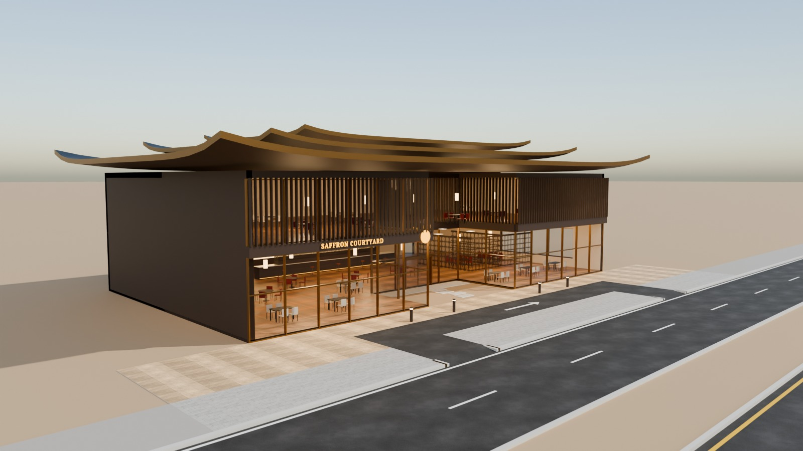
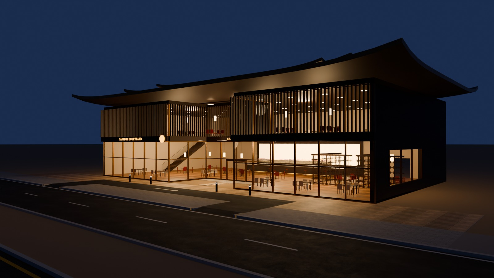
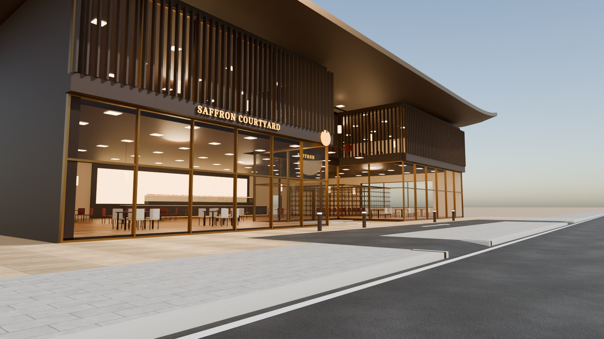
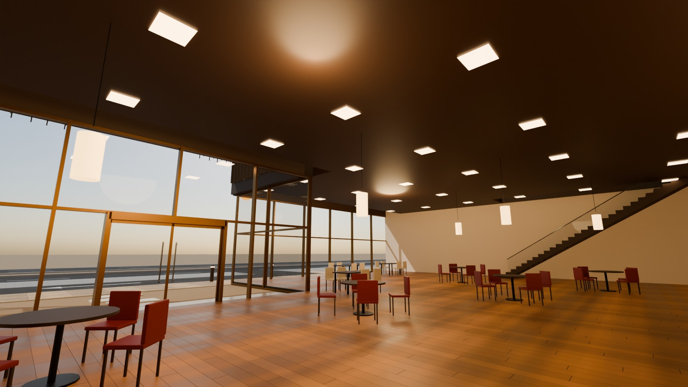

# 09 - Saffron Courtyard

*C - Long-frontage restaurant* - status: **incomplete**

Massing: 38 m frontage whose middle 10 m is carved back 6 m into an entrance COURTYARD with a reflecting pool and stepping stones.  The ground floor is a long bronze-framed horizontal glass band; the upper dining level is veiled by dense dark-timber vertical battens (strong vertical rhythm).  The whole is crowned by three stacked, progressively smaller roof plates with upturned edges and corners (contemporary pagoda silhouette). Inside: sushi / display counter, private dining rooms behind timber lattice screens, paper-lantern pendants, straight stair to the upper dining room. Site: compact drop-off lay-by in front of the courtyard (in/out crossings), no parking.

## Previews






## Key facts

| Item | Value |
|---|---|
| Storeys | 2 (floor levels [0.15, 5.2] m, roof stacked upturned plates, top 12.3 m) |
| Frontage x depth x height | 44.0 x 27.0 x 12.3 m |
| LOD0 bounds (Blender) | [44.0, 27.0, 12.78] m |
| Setback from plot frontage | 6.0 m |
| Parking | none - compact drop-off lay-by (OPTIONAL_FORECOURT) |
| Vehicle access | in/out crossings to a drop-off lay-by in front of the courtyard |
| Glass | GF bronze-framed PC_Glass band + L1 glass behind timber battens |
| Lights | {'INTERIOR_LIGHTING': 5, 'EXTERIOR_LIGHTING': 2} |
| Collision boxes | 1 |

## Files

- `saffron_courtyard.blend` - full editable Blender 4.5.15 LTS scene (textures referenced relatively from `textures/`).
- `saffron_courtyard.glb` - presentation export: LOD0/1/2 + site pieces + placeholder cars + lights + collision, textures embedded.
- (no placeholder cars in this asset, so the main GLB is already building-only)
- `lod/` - geometry-only per-LOD GLBs used for independent triangle read-back (+ placeholder cars GLB where present), `build_stats.json`.
- `textures/` - procedural PBR maps (JPEG albedo/ORM/normal) + PNG brand/screen graphics.
- `renders/` - four 1600x900 Cycles JPEGs + `render_report.json` (ray-traced visibility checks).
- `validation.json` - fresh-process validation results.

## Triangles (read from the exported GLB)

| LOD0 | LOD1 | LOD2 | Placeholder cars | Site pieces | Collision |
|---|---|---|---|---|---|
| 54664 | 13377 | 1762 | 0 | 452 | 12 |

LOD visibility ranges (glTF extras, applied by `../premium_lod_post_import.gd`): {'LOD0': [0.0, 90.0], 'LOD1': [90.0, 260.0], 'LOD2': [260.0, 1600.0]}; placeholder cars 0-340 m.

## Hierarchy

```
P09_<Title> (root, origin = centre of the plot frontage line, ground; front = -Y Blender / +Z glTF)
  LOD0/1/2 -> BUILDING_EXTERIOR, BUILDING_INTERIOR, GLASS_SYSTEM, FACADE_DETAILS, SIGNAGE, FURNITURE, DISPLAY_OBJECTS
  SIDEWALK_FRONTAGE, OPTIONAL_FORECOURT, DRIVEWAY, OPTIONAL_PARKING   (separate, removable site pieces)
  PLACEHOLDER_CARS (one object per car)   INTERIOR_LIGHTING   EXTERIOR_LIGHTING   COLLISION (*-convcolonly)
```

## Validation

- Result: **PASS**; issues: []; warnings: []
- Degenerate faces: 1; inverted faces in watertight pieces: 0; vegetation: none
- Glass materials: {'PC_Glass': {'alpha': 0.16, 'blend': 'BLEND', 'double_sided': True}, 'PC_GlassClear': {'alpha': 0.11, 'blend': 'BLEND', 'double_sided': True}, 'PC_GlassRail': {'alpha': 0.14, 'blend': 'BLEND', 'double_sided': True}}
- GLB re-import into a clean scene: {'mesh_objects': 65, 'triangles': 70267, 'glb_triangles': 70267, 'images_loaded': 22, 'lights': 7, 'lod0_size_yup_converted': [44.0, 27.0, 12.78]}

Brand note: Original fictional brand.

Godot import has NOT been tested from the cloud session. If you copy this folder into a Godot project, delete or exclude the `.blend` (Godot would try to import it) - `textures/` and `renders/` contain `.gdignore`.
