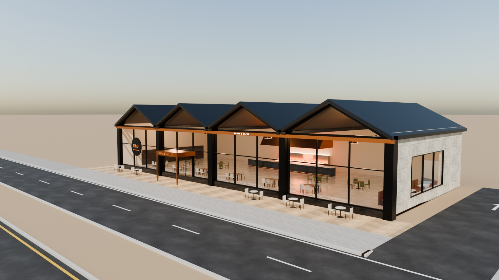
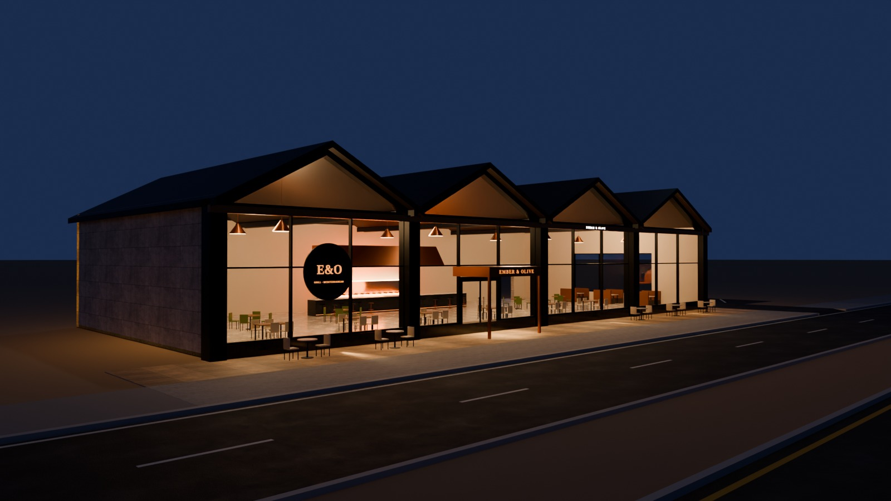
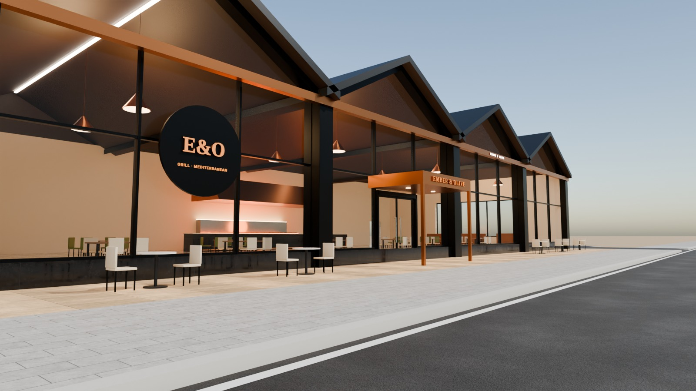
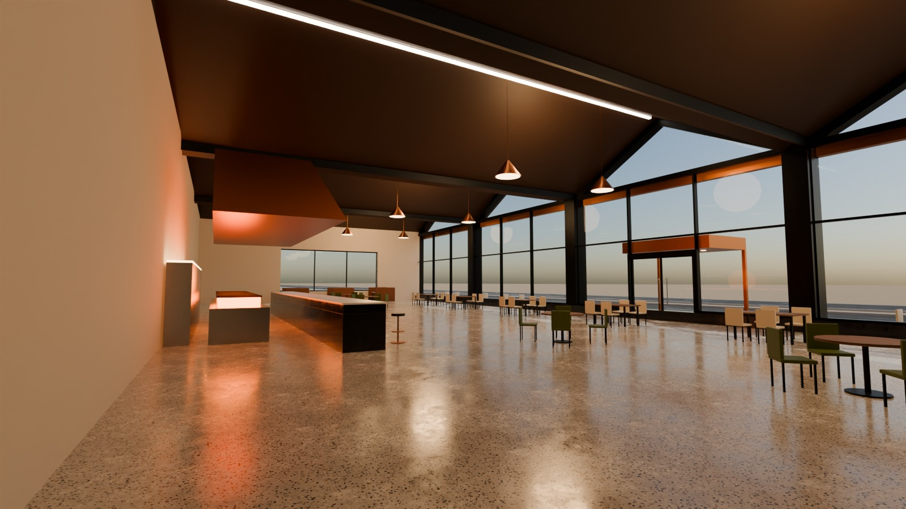

# 10 - Ember & Olive

*C - Long-frontage restaurant* - status: **incomplete**

Massing: 40 m frontage of FOUR road-facing gables (dark standing-seam roofs, ridges at 9.1 m), each bay a black-steel portal frame holding a 9 m wide floor-to-eave window with a glazed gable triangle above - strong dark framing on a dark stone plinth, warm copper eave beam carrying the name, a projecting copper entrance box in bay 2. Inside: open dining under timber-lined gable ceilings, a central grill feature counter with copper hood and live-fire glow (display kitchen), wine wall, booths and dome pendants. Site: frontage paving directly off the pavement, optional ANGLED side parking on the right (separate collection).

## Previews






## Key facts

| Item | Value |
|---|---|
| Storeys | 1 (tall, gabled) (floor levels [0.15] m, roof 4 gables, eaves 6.5 m, ridges 9.1 m) |
| Frontage x depth x height | 40.0 x 18.0 x 9.1 m |
| LOD0 bounds (Blender) | - m |
| Setback from plot frontage | 4.0 m |
| Parking | optional angled side parking, 6 bays (OPTIONAL_PARKING) |
| Vehicle access | right crossing to angled side parking |
| Glass | 4 x 9.3 m bay windows + glazed gables (PC_Glass) |
| Lights | None |
| Collision boxes | None |

## Files

- `ember_and_olive.blend` - full editable Blender 4.5.15 LTS scene (textures referenced relatively from `textures/`).
- `ember_and_olive.glb` - presentation export: LOD0/1/2 + site pieces + placeholder cars + lights + collision, textures embedded.
- (no placeholder cars in this asset, so the main GLB is already building-only)
- `lod/` - geometry-only per-LOD GLBs used for independent triangle read-back (+ placeholder cars GLB where present), `build_stats.json`.
- `textures/` - procedural PBR maps (JPEG albedo/ORM/normal) + PNG brand/screen graphics.
- `renders/` - four 1600x900 Cycles JPEGs + `render_report.json` (ray-traced visibility checks).
- `validation.json` - fresh-process validation results.

## Triangles (read from the exported GLB)

| LOD0 | LOD1 | LOD2 | Placeholder cars | Site pieces | Collision |
|---|---|---|---|---|---|
| None | None | None | 0 | 0 | None |

LOD visibility ranges (glTF extras, applied by `../premium_lod_post_import.gd`): {}; placeholder cars 0-340 m.

## Hierarchy

```
P10_<Title> (root, origin = centre of the plot frontage line, ground; front = -Y Blender / +Z glTF)
  LOD0/1/2 -> BUILDING_EXTERIOR, BUILDING_INTERIOR, GLASS_SYSTEM, FACADE_DETAILS, SIGNAGE, FURNITURE, DISPLAY_OBJECTS
  SIDEWALK_FRONTAGE, OPTIONAL_FORECOURT, DRIVEWAY, OPTIONAL_PARKING   (separate, removable site pieces)
  PLACEHOLDER_CARS (one object per car)   INTERIOR_LIGHTING   EXTERIOR_LIGHTING   COLLISION (*-convcolonly)
```

## Validation

- Result: **FAIL**; issues: None; warnings: None
- Degenerate faces: None; inverted faces in watertight pieces: None; vegetation: none
- Glass materials: None
- GLB re-import into a clean scene: None

Brand note: Original fictional brand.

Godot import has NOT been tested from the cloud session. If you copy this folder into a Godot project, delete or exclude the `.blend` (Godot would try to import it) - `textures/` and `renders/` contain `.gdignore`.
