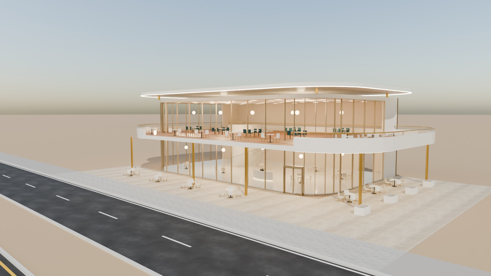
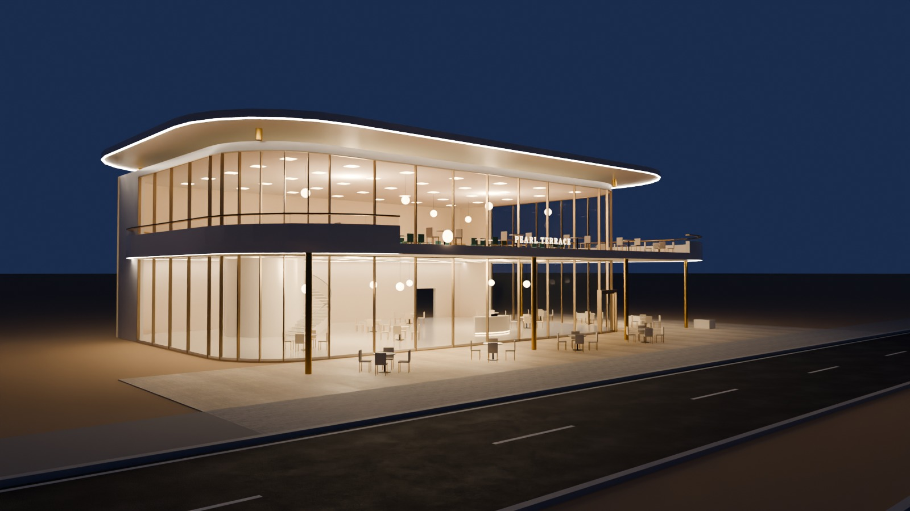
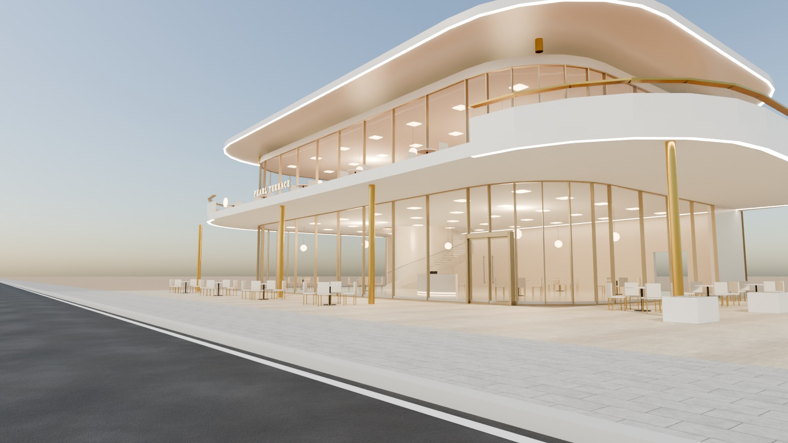
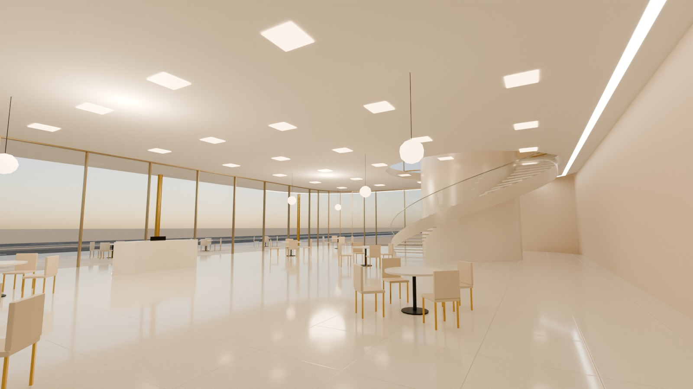

# 11 - Pearl Terrace

*C - Long-frontage restaurant* - status: **complete**

Massing: a soft, pearl-white two-storey volume with fully rounded corners.  The upper dining room is wrapped by a deep cantilevered BALCONY TERRACE (rounded, 4 m projection on the front, 6 m over the side terrace) with a solid pearl parapet and a glass top rail; the ground floor sits back behind a full-height terrace-facing glass wall. A thin rounded roof canopy with a ring of LED floats above.  Footprint is wider than deep with a side garden terrace (empty stone planters only) under the balcony overhang. Inside: grand sweeping curved staircase, premium reception with a chandelier ring, visible upper floor. Site: terrace directly beside the pavement; no parking.

## Previews






## Key facts

| Item | Value |
|---|---|
| Storeys | 2 (floor levels [0.15, 5.2] m, roof 9.8) |
| Frontage x depth x height | 34.0 x 22.0 x 10.65 m |
| LOD0 bounds (Blender) | [36.0, 22.9, 10.95] m |
| Setback from plot frontage | 4.0 m |
| Parking | none (front + side terraces beside the pavement) |
| Vehicle access | pedestrian; no vehicle access |
| Glass | rounded champagne-framed PC_GlassClear walls on both floors |
| Lights | {'INTERIOR_LIGHTING': 4, 'EXTERIOR_LIGHTING': 2} |
| Collision boxes | 3 |

## Files

- `pearl_terrace.blend` - full editable Blender 4.5.15 LTS scene (textures referenced relatively from `textures/`).
- `pearl_terrace.glb` - presentation export: LOD0/1/2 + site pieces + placeholder cars + lights + collision, textures embedded.
- (no placeholder cars in this asset, so the main GLB is already building-only)
- `lod/` - geometry-only per-LOD GLBs used for independent triangle read-back (+ placeholder cars GLB where present), `build_stats.json`.
- `textures/` - procedural PBR maps (JPEG albedo/ORM/normal) + PNG brand/screen graphics.
- `renders/` - four 1600x900 Cycles JPEGs + `render_report.json` (ray-traced visibility checks).
- `validation.json` - fresh-process validation results.

## Triangles (read from the exported GLB)

| LOD0 | LOD1 | LOD2 | Placeholder cars | Site pieces | Collision |
|---|---|---|---|---|---|
| 39494 | 9633 | 1287 | 0 | 4936 | 36 |

LOD visibility ranges (glTF extras, applied by `../premium_lod_post_import.gd`): {'LOD0': [0.0, 90.0], 'LOD1': [90.0, 260.0], 'LOD2': [260.0, 1600.0]}; placeholder cars 0-340 m.

## Hierarchy

```
P11_<Title> (root, origin = centre of the plot frontage line, ground; front = -Y Blender / +Z glTF)
  LOD0/1/2 -> BUILDING_EXTERIOR, BUILDING_INTERIOR, GLASS_SYSTEM, FACADE_DETAILS, SIGNAGE, FURNITURE, DISPLAY_OBJECTS
  SIDEWALK_FRONTAGE, OPTIONAL_FORECOURT, DRIVEWAY, OPTIONAL_PARKING   (separate, removable site pieces)
  PLACEHOLDER_CARS (one object per car)   INTERIOR_LIGHTING   EXTERIOR_LIGHTING   COLLISION (*-convcolonly)
```

## Validation

- Result: **PASS**; issues: []; warnings: []
- Degenerate faces: 0; inverted faces in watertight pieces: 0; vegetation: none
- Glass materials: {'PC_GlassClear': {'alpha': 0.11, 'blend': 'BLEND', 'double_sided': True}, 'PC_GlassRail': {'alpha': 0.14, 'blend': 'BLEND', 'double_sided': True}}
- GLB re-import into a clean scene: {'mesh_objects': 51, 'triangles': 55386, 'glb_triangles': 55386, 'images_loaded': 18, 'lights': 6, 'lod0_size_yup_converted': [36.0, 22.9, 10.95]}
- Ray-traced visibility from the road_view camera: cars readable 0/0 {}; interior probes reached 1/3 {'GF_dining': False, 'L1_dining': False, 'Stair': True}
- Ray-traced visibility from the day camera: cars readable 0/0 {}; interior probes reached 3/3 {'GF_dining': True, 'L1_dining': True, 'Stair': True}

Brand note: Original fictional brand.

Godot import has NOT been tested from the cloud session. If you copy this folder into a Godot project, delete or exclude the `.blend` (Godot would try to import it) - `textures/` and `renders/` contain `.gdignore`.
