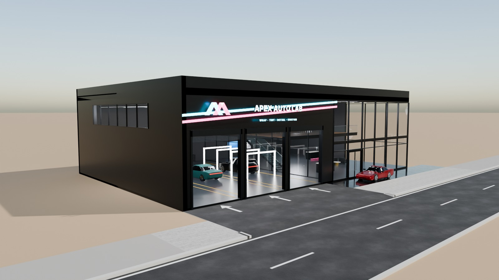
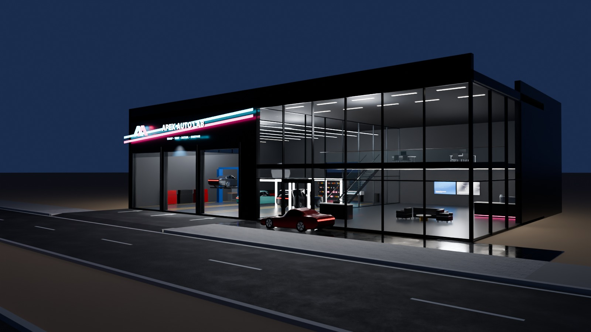
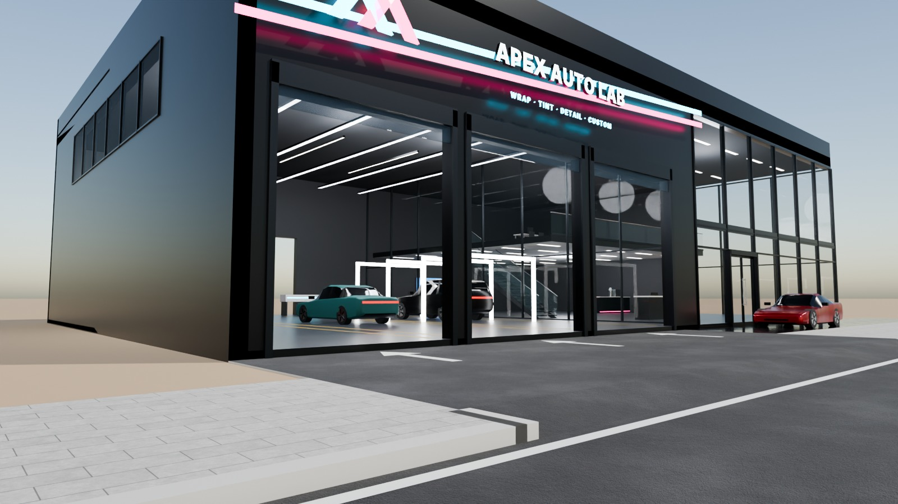
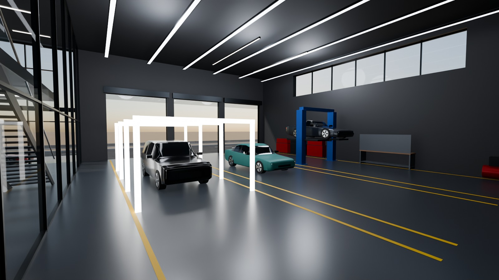

# 12 - Apex Auto Lab

*D - Automotive service facility* - status: **incomplete**

Massing: compact black industrial box only 3 m from the pavement.  Three tall glass sectional doors (raised) open the workshop bays straight to the road; a diagonal cyan/magenta neon stripe slices across the black cladding and over the glass-box customer lounge on the right (double-height glazing with an office mezzanine).  Illuminated chevron + name. Inside: bay 1 car on a 2-post lift, bay 2 car being wrapped (vinyl racks, plotter), bay 3 detailing car inside an LED light-tunnel frame; tool cabinets, workbench, industrial strip lights; lounge with coffee bar. Site: direct road-facing apron to the bays (wide crossing), no parking.

## Previews






## Key facts

| Item | Value |
|---|---|
| Storeys | 1 (+ lounge office mezzanine) (floor levels [0.15, 4.0] m, roof 8.6) |
| Frontage x depth x height | 32.0 x 22.0 x 9.4 m |
| LOD0 bounds (Blender) | - m |
| Setback from plot frontage | 3.0 m |
| Parking | none |
| Vehicle access | 16 m wide road-facing crossing straight to three raised glass bay doors |
| Glass | glass sectional bay doors (PC_GlassBlue) + lounge PC_Glass box |
| Lights | None |
| Collision boxes | None |

## Files

- `apex_auto_lab.blend` - full editable Blender 4.5.15 LTS scene (textures referenced relatively from `textures/`).
- `apex_auto_lab.glb` - presentation export: LOD0/1/2 + site pieces + placeholder cars + lights + collision, textures embedded.
- `apex_auto_lab_building_only.glb` - identical but WITHOUT the `PLACEHOLDER_CARS` node.
- `lod/` - geometry-only per-LOD GLBs used for independent triangle read-back (+ placeholder cars GLB where present), `build_stats.json`.
- `textures/` - procedural PBR maps (JPEG albedo/ORM/normal) + PNG brand/screen graphics.
- `renders/` - four 1600x900 Cycles JPEGs + `render_report.json` (ray-traced visibility checks).
- `validation.json` - fresh-process validation results.

## Triangles (read from the exported GLB)

| LOD0 | LOD1 | LOD2 | Placeholder cars | Site pieces | Collision |
|---|---|---|---|---|---|
| None | None | None | 0 | 0 | None |

LOD visibility ranges (glTF extras, applied by `../premium_lod_post_import.gd`): {}; placeholder cars 0-340 m.

## Hierarchy

```
P12_<Title> (root, origin = centre of the plot frontage line, ground; front = -Y Blender / +Z glTF)
  LOD0/1/2 -> BUILDING_EXTERIOR, BUILDING_INTERIOR, GLASS_SYSTEM, FACADE_DETAILS, SIGNAGE, FURNITURE, DISPLAY_OBJECTS
  SIDEWALK_FRONTAGE, OPTIONAL_FORECOURT, DRIVEWAY, OPTIONAL_PARKING   (separate, removable site pieces)
  PLACEHOLDER_CARS (one object per car)   INTERIOR_LIGHTING   EXTERIOR_LIGHTING   COLLISION (*-convcolonly)
```

## Placeholder cars

Generic, badge-free silhouettes for replacement by the game's own vehicles. Each car is ONE object (pivot at ground centre, nose = local +X). Remove them all by deleting the `PLACEHOLDER_CARS` collection in Blender, by using `apex_auto_lab_building_only.glb`, or in Godot via the `premium_placeholder_cars` group.

| Object | Class | L x W x H (m) | Position (m) | Heading | Role | Tris |
|---|---|---|---|---|---|---|
| `P12_CAR_01_Coupe_CarPaintGraphite` | coupe | 4.55 x 1.92 x 1.29 | [-13.0, 13.0, 1.85] | 90 | bay 1 on 2-post lift (raised) | 2176 |
| `P12_CAR_02_Sedan_CarWrapMatte` | sedan | 4.95 x 1.88 x 1.45 | [-8.0, 12.5, 0.15] | 90 | bay 2 wrap station | 2232 |
| `P12_CAR_03_Suv_CarPaintBlack` | suv | 4.95 x 1.96 x 1.76 | [-3.0, 12.8, 0.15] | 90 | bay 3 detailing light tunnel | 2204 |
| `P12_CAR_04_Coupe_CarPaintRed` | coupe | 4.55 x 1.92 x 1.29 | [6.0, 1.4, 0.0] | 180 | waiting on the apron (optional) | 2176 |

## Validation

- Result: **FAIL**; issues: None; warnings: None
- Degenerate faces: None; inverted faces in watertight pieces: None; vegetation: none
- Glass materials: None
- GLB re-import into a clean scene: None

Brand note: Original fictional brand.

Godot import has NOT been tested from the cloud session. If you copy this folder into a Godot project, delete or exclude the `.blend` (Godot would try to import it) - `textures/` and `renders/` contain `.gdignore`.
