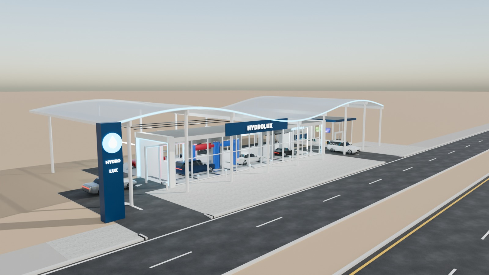
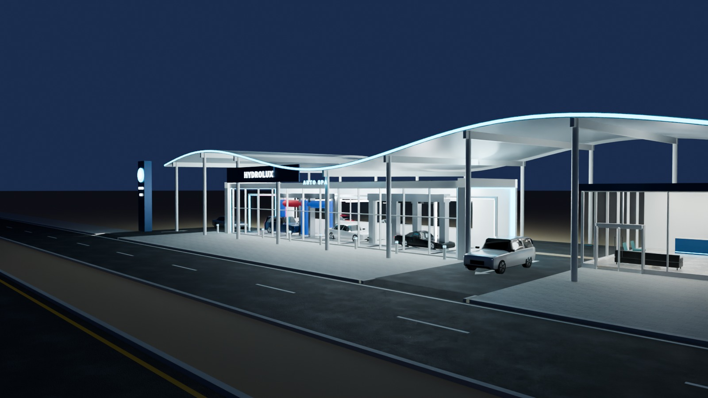
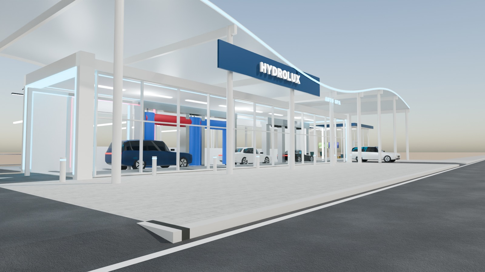
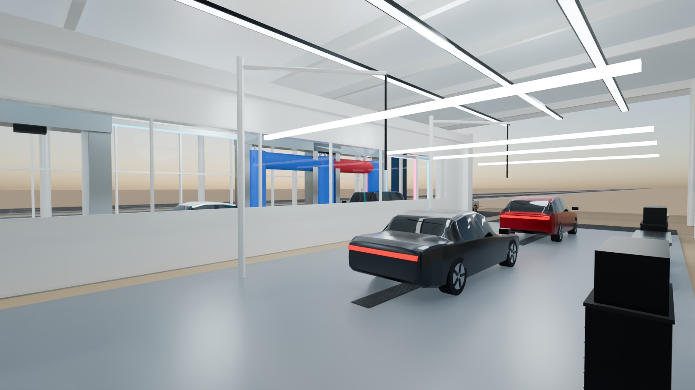

# 13 - HydroLux Auto Spa

*D - Automotive service facility* - status: **incomplete**

Massing: a 28 m drive-through wash TUNNEL running PARALLEL to the road behind a full glass side wall, so the whole wash sequence (spray arches, brushes, blowers, LED arch) is visible to passing drivers.  Over everything floats a large WAVE canopy of translucent panels on white portal frames.  Two open detailing bays sit behind the tunnel and a glass customer lounge overlooks the exit.  Separate ENTRY (left) and EXIT (right) crossings from the service road. Inside: wash equipment, floor drainage grates, guide rail, detailing carts / vacuum booms, aqua LED lighting.

## Previews






## Key facts

| Item | Value |
|---|---|
| Storeys | 1 (floor levels [0.05, 0.2] m, roof translucent wave canopy 6.1-8.9 m over a 4.6 m tunnel) |
| Frontage x depth x height | 50.0 x 19.2 x 8.9 m |
| LOD0 bounds (Blender) | - m |
| Setback from plot frontage | 2.8 m |
| Parking | none (queue lane only) |
| Vehicle access | separate ENTRY (left) and EXIT (right) crossings; tunnel runs parallel to the road |
| Glass | glass tunnel side wall + glass lounge |
| Lights | None |
| Collision boxes | None |

## Files

- `hydrolux_auto_spa.blend` - full editable Blender 4.5.15 LTS scene (textures referenced relatively from `textures/`).
- `hydrolux_auto_spa.glb` - presentation export: LOD0/1/2 + site pieces + placeholder cars + lights + collision, textures embedded.
- `hydrolux_auto_spa_building_only.glb` - identical but WITHOUT the `PLACEHOLDER_CARS` node.
- `lod/` - geometry-only per-LOD GLBs used for independent triangle read-back (+ placeholder cars GLB where present), `build_stats.json`.
- `textures/` - procedural PBR maps (JPEG albedo/ORM/normal) + PNG brand/screen graphics.
- `renders/` - four 1600x900 Cycles JPEGs + `render_report.json` (ray-traced visibility checks).
- `validation.json` - fresh-process validation results.

## Triangles (read from the exported GLB)

| LOD0 | LOD1 | LOD2 | Placeholder cars | Site pieces | Collision |
|---|---|---|---|---|---|
| None | None | None | 0 | 0 | None |

LOD visibility ranges (glTF extras, applied by `../premium_lod_post_import.gd`): {}; placeholder cars 0-340 m.

## Hierarchy

```
P13_<Title> (root, origin = centre of the plot frontage line, ground; front = -Y Blender / +Z glTF)
  LOD0/1/2 -> BUILDING_EXTERIOR, BUILDING_INTERIOR, GLASS_SYSTEM, FACADE_DETAILS, SIGNAGE, FURNITURE, DISPLAY_OBJECTS
  SIDEWALK_FRONTAGE, OPTIONAL_FORECOURT, DRIVEWAY, OPTIONAL_PARKING   (separate, removable site pieces)
  PLACEHOLDER_CARS (one object per car)   INTERIOR_LIGHTING   EXTERIOR_LIGHTING   COLLISION (*-convcolonly)
```

## Placeholder cars

Generic, badge-free silhouettes for replacement by the game's own vehicles. Each car is ONE object (pivot at ground centre, nose = local +X). Remove them all by deleting the `PLACEHOLDER_CARS` collection in Blender, by using `hydrolux_auto_spa_building_only.glb`, or in Godot via the `premium_placeholder_cars` group.

| Object | Class | L x W x H (m) | Position (m) | Heading | Role | Tris |
|---|---|---|---|---|---|---|
| `P13_CAR_01_Sedan_CarPaintSilver` | sedan | 4.95 x 1.88 x 1.45 | [-21.0, 9.0, 0.0] | 0 | queue at the tunnel entry | 2232 |
| `P13_CAR_02_Suv_CarPaintBlue` | suv | 4.95 x 1.96 x 1.76 | [-10.5, 9.0, 0.05] | 0 | inside wash tunnel (brushes) | 2204 |
| `P13_CAR_03_Sedan_CarPaintWhite` | sedan | 4.95 x 1.88 x 1.45 | [-1.5, 9.0, 0.05] | 0 | inside wash tunnel (spray arch) | 2232 |
| `P13_CAR_04_Coupe_CarPaintBlack` | coupe | 4.55 x 1.92 x 1.29 | [6.5, 9.0, 0.05] | 0 | inside wash tunnel (blowers) | 2176 |
| `P13_CAR_05_Crossover_CarPaintRed` | crossover | 4.6 x 1.88 x 1.62 | [-12.0, 17.0, 0.05] | 180 | detailing bay 1 | 2204 |
| `P13_CAR_06_Sedan_CarPaintGraphite` | sedan | 4.95 x 1.88 x 1.45 | [-4.0, 17.0, 0.05] | 180 | detailing bay 2 | 2232 |
| `P13_CAR_07_Suv_CarPaintWhite` | suv | 4.95 x 1.96 x 1.76 | [15.5, 4.2, 0.0] | -90 | leaving via the exit lane | 2204 |

## Validation

- Result: **FAIL**; issues: None; warnings: None
- Degenerate faces: None; inverted faces in watertight pieces: None; vegetation: none
- Glass materials: None
- GLB re-import into a clean scene: None

Brand note: Original fictional brand.

Godot import has NOT been tested from the cloud session. If you copy this folder into a Godot project, delete or exclude the `.blend` (Godot would try to import it) - `textures/` and `renders/` contain `.gdignore`.
