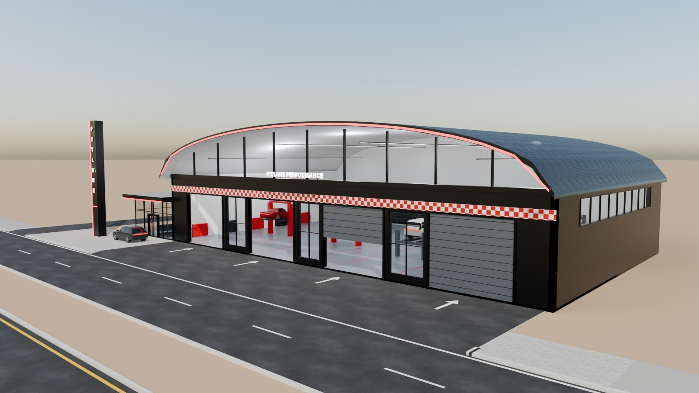
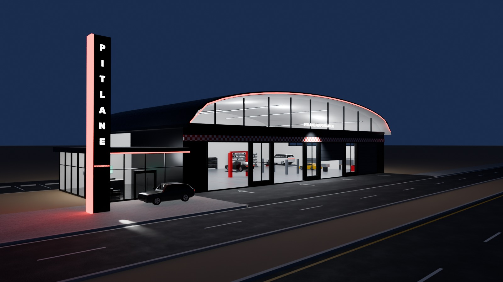
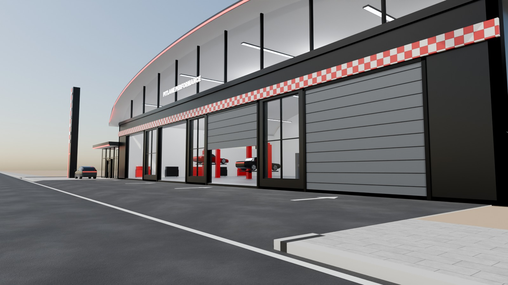
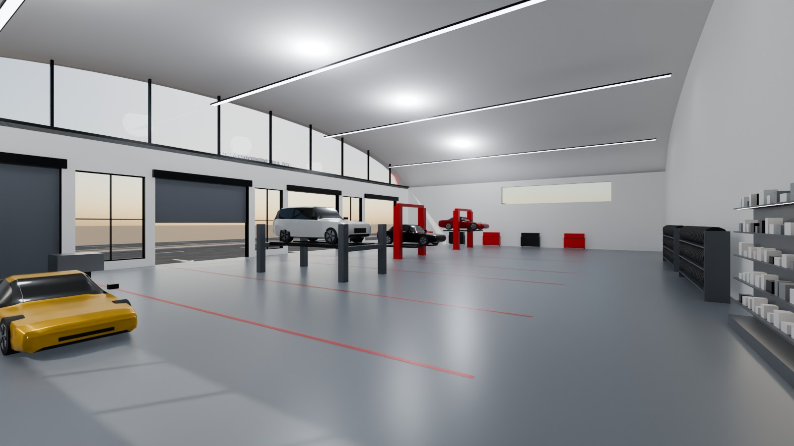

# 14 - Pitlane Performance

*D - Automotive service facility* - status: **incomplete**

Massing: a 41 m wide racing-hangar with a BARREL-VAULT roof whose arched gable faces the road (eaves 7 m, crown 11.4 m). The lower front holds four big roller doors (two open, one half-open, one closed) separated by full-height glass observation panels; the arched lunette above is glazed so the lit workshop reads from the road.  A low glass service reception box sits on the left beside a tall black/red vertical sign blade.  Red/white chequer band at the doors. Inside: two 2-post lifts and a 4-post lift with raised cars, a car on the floor with the bonnet zone lit, engine stand, tyre machine + racks, tool cabinets, workbenches and long high-bay lights following the vault. Site: wide workshop apron straight off the service road; optional customer parking left of the reception.

## Previews






## Key facts

| Item | Value |
|---|---|
| Storeys | 1 (floor levels [0.15] m, roof barrel vault, eaves 7.0 m, crown 11.75 m) |
| Frontage x depth x height | 50.5 x 27.2 x 11.75 m |
| LOD0 bounds (Blender) | - m |
| Setback from plot frontage | 5.0 m |
| Parking | optional left customer parking, 6 bays (OPTIONAL_PARKING) |
| Vehicle access | 40 m wide workshop apron straight off the service road to four roller doors; separate parking crossing |
| Glass | glass observation panels + glazed arched lunette + glass reception box |
| Lights | None |
| Collision boxes | None |

## Files

- `pitlane_performance.blend` - full editable Blender 4.5.15 LTS scene (textures referenced relatively from `textures/`).
- `pitlane_performance.glb` - presentation export: LOD0/1/2 + site pieces + placeholder cars + lights + collision, textures embedded.
- `pitlane_performance_building_only.glb` - identical but WITHOUT the `PLACEHOLDER_CARS` node.
- `lod/` - geometry-only per-LOD GLBs used for independent triangle read-back (+ placeholder cars GLB where present), `build_stats.json`.
- `textures/` - procedural PBR maps (JPEG albedo/ORM/normal) + PNG brand/screen graphics.
- `renders/` - four 1600x900 Cycles JPEGs + `render_report.json` (ray-traced visibility checks).
- `validation.json` - fresh-process validation results.

## Triangles (read from the exported GLB)

| LOD0 | LOD1 | LOD2 | Placeholder cars | Site pieces | Collision |
|---|---|---|---|---|---|
| None | None | None | 0 | 0 | None |

LOD visibility ranges (glTF extras, applied by `../premium_lod_post_import.gd`): {}; placeholder cars 0-340 m.

## Hierarchy

```
P14_<Title> (root, origin = centre of the plot frontage line, ground; front = -Y Blender / +Z glTF)
  LOD0/1/2 -> BUILDING_EXTERIOR, BUILDING_INTERIOR, GLASS_SYSTEM, FACADE_DETAILS, SIGNAGE, FURNITURE, DISPLAY_OBJECTS
  SIDEWALK_FRONTAGE, OPTIONAL_FORECOURT, DRIVEWAY, OPTIONAL_PARKING   (separate, removable site pieces)
  PLACEHOLDER_CARS (one object per car)   INTERIOR_LIGHTING   EXTERIOR_LIGHTING   COLLISION (*-convcolonly)
```

## Placeholder cars

Generic, badge-free silhouettes for replacement by the game's own vehicles. Each car is ONE object (pivot at ground centre, nose = local +X). Remove them all by deleting the `PLACEHOLDER_CARS` collection in Blender, by using `pitlane_performance_building_only.glb`, or in Godot via the `premium_placeholder_cars` group.

| Object | Class | L x W x H (m) | Position (m) | Heading | Role | Tris |
|---|---|---|---|---|---|---|
| `P14_CAR_01_Coupe_CarPaintRed` | coupe | 4.55 x 1.92 x 1.29 | [-14.5, 15.0, 1.95] | 90 | bay 1 on 2-post lift (raised) | 2176 |
| `P14_CAR_02_Sedan_CarPaintBlack` | sedan | 4.95 x 1.88 x 1.45 | [-4.5, 15.0, 1.05] | 90 | bay 2 on 2-post lift (half raised) | 2232 |
| `P14_CAR_03_Suv_CarPaintWhite` | suv | 4.95 x 1.96 x 1.76 | [5.0, 15.5, 1.65] | 90 | bay 3 on 4-post lift | 2204 |
| `P14_CAR_04_Coupe_CarPaintYellow` | coupe | 4.55 x 1.92 x 1.29 | [15.0, 17.0, 0.15] | 90 | bay 4 floor service | 2176 |
| `P14_CAR_05_Crossover_CarPaintGraphite` | crossover | 4.6 x 1.88 x 1.62 | [-24.0, 2.0, 0.0] | 180 | customer drop-off at reception | 2204 |

## Validation

- Result: **FAIL**; issues: None; warnings: None
- Degenerate faces: None; inverted faces in watertight pieces: None; vegetation: none
- Glass materials: None
- GLB re-import into a clean scene: None

Brand note: Original fictional brand.

Godot import has NOT been tested from the cloud session. If you copy this folder into a Godot project, delete or exclude the `.blend` (Godot would try to import it) - `textures/` and `renders/` contain `.gdignore`.
