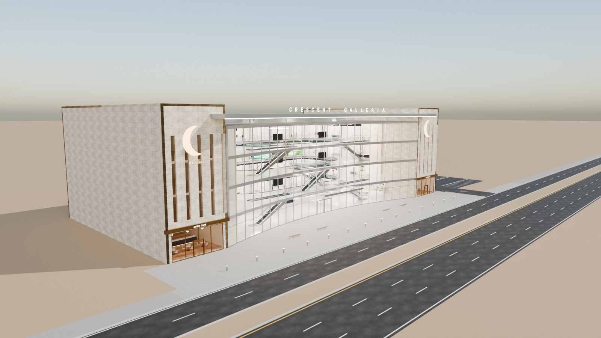
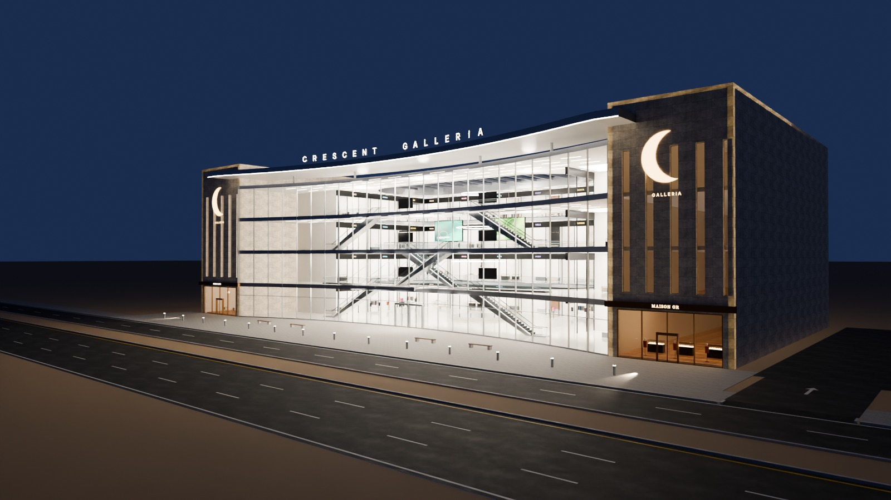
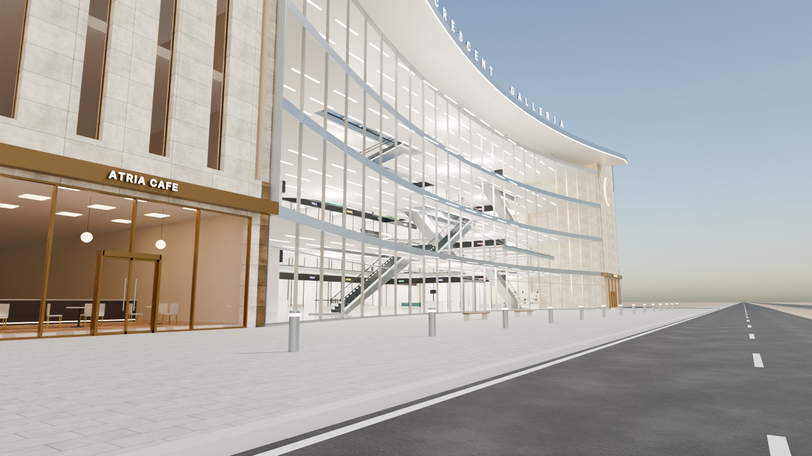
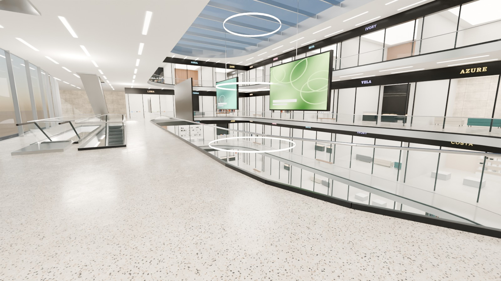

# 15 - Crescent Galleria

*E - Four-storey shopping mall* - status: **incomplete**

Massing: 90 m frontage.  A 66 m CONCAVE (crescent) four-storey glass curtain wall with silver floor spandrels and fins is held between two taller stone 'bookend' towers that carry their own street-facing shopfronts (separate commercial frontage sections).  A crescent-shaped canopy crowns the glass with the name; a long glass entrance canopy marks the central doors; a glazed skylight covers the atrium. Interior (real 3D): four floors (0.15 / 5.6 / 11.0 / 16.4 m), a stadium-shaped central atrium through all levels with glass-railed galleries, SIX escalators placed in the glazed front zone (zig-zag GF->L1 at the sides, L1->L2 in the centre, L2->L3 at the sides) so circulation and floor separation read from the road, 56 shop units (14 per floor) with glass shopfronts, illuminated sign bands and display fixtures, kiosks, benches, hanging LED screens, atrium pool. Site: entrance plaza on the frontage; OPTIONAL surface car park on the right (separate collection, own crossing).

## Previews






## Key facts

| Item | Value |
|---|---|
| Storeys | 4 (floor levels [0.15, 5.6, 11.0, 16.4] m, roof 21.8) |
| Frontage x depth x height | 90.0 x 45.0 x 25.5 m |
| LOD0 bounds (Blender) | - m |
| Setback from plot frontage | 10.0 m |
| Parking | optional right-side surface car park, 32 bays (OPTIONAL_PARKING) |
| Vehicle access | pedestrian entrance plaza on the frontage; separate right crossing to the optional car park |
| Glass | 66 m concave crescent curtain wall PC_Glass alpha 0.16 + skylight |
| Lights | None |
| Collision boxes | None |

## Files

- `crescent_galleria.blend` - full editable Blender 4.5.15 LTS scene (textures referenced relatively from `textures/`).
- `crescent_galleria.glb` - presentation export: LOD0/1/2 + site pieces + placeholder cars + lights + collision, textures embedded.
- (no placeholder cars in this asset, so the main GLB is already building-only)
- `lod/` - geometry-only per-LOD GLBs used for independent triangle read-back (+ placeholder cars GLB where present), `build_stats.json`.
- `textures/` - procedural PBR maps (JPEG albedo/ORM/normal) + PNG brand/screen graphics.
- `renders/` - four 1600x900 Cycles JPEGs + `render_report.json` (ray-traced visibility checks).
- `validation.json` - fresh-process validation results.

## Triangles (read from the exported GLB)

| LOD0 | LOD1 | LOD2 | Placeholder cars | Site pieces | Collision |
|---|---|---|---|---|---|
| None | None | None | 0 | 0 | None |

LOD visibility ranges (glTF extras, applied by `../premium_lod_post_import.gd`): {}; placeholder cars 0-340 m.

## Hierarchy

```
P15_<Title> (root, origin = centre of the plot frontage line, ground; front = -Y Blender / +Z glTF)
  LOD0/1/2 -> BUILDING_EXTERIOR, BUILDING_INTERIOR, GLASS_SYSTEM, FACADE_DETAILS, SIGNAGE, FURNITURE, DISPLAY_OBJECTS
  SIDEWALK_FRONTAGE, OPTIONAL_FORECOURT, DRIVEWAY, OPTIONAL_PARKING   (separate, removable site pieces)
  PLACEHOLDER_CARS (one object per car)   INTERIOR_LIGHTING   EXTERIOR_LIGHTING   COLLISION (*-convcolonly)
```

## Validation

- Result: **FAIL**; issues: None; warnings: None
- Degenerate faces: None; inverted faces in watertight pieces: None; vegetation: none
- Glass materials: None
- GLB re-import into a clean scene: None

Brand note: Original fictional mall; shop names (MAISON, NOVA, LUXE ...) are invented.

Godot import has NOT been tested from the cloud session. If you copy this folder into a Godot project, delete or exclude the `.blend` (Godot would try to import it) - `textures/` and `renders/` contain `.gdignore`.
