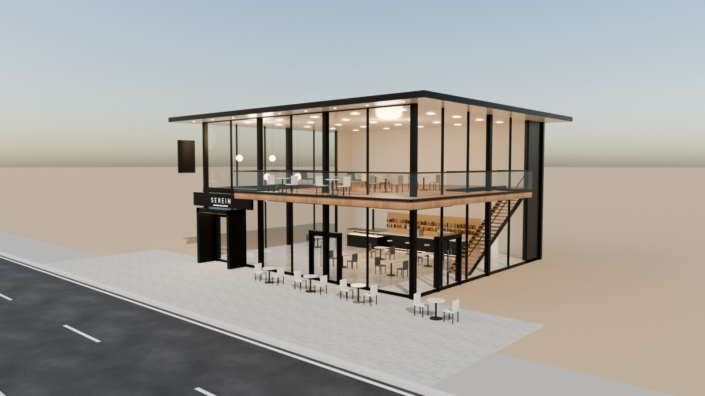
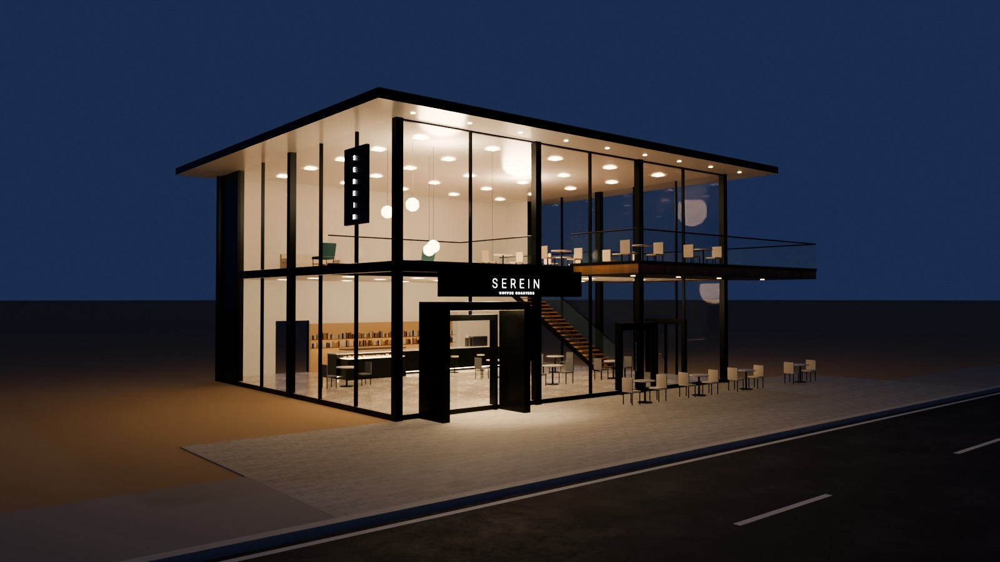
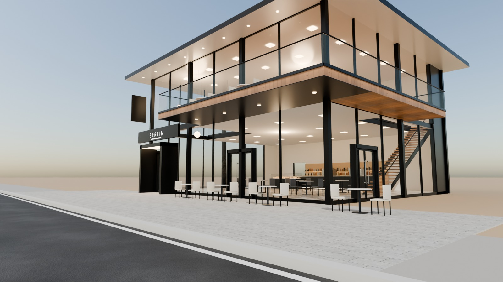
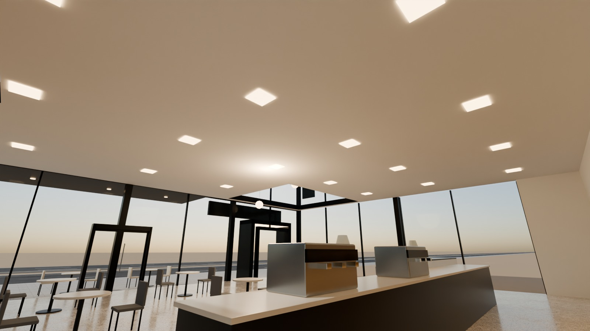

# 16 - Serein Cafe

*F - Two-storey luxury cafe* - status: **incomplete**

Massing: a slender 16 x 14 m glass pavilion in a fine black-steel frame (exposed corner + mid columns, thin floor edge), a razor-thin flat roof plane with a 1.6 m white soffit overhang, and an upper TERRACE BALCONY cantilevered 3 m over the pavement on the right half (wrapping the right corner) with frameless glass railing.  Entrance through a deep black-steel pivot-door portal on the left, opening into a double-height void with globe pendants. Inside: coffee counter with espresso machines + pastry case, tables, upstairs lounge seating with glass balustrade, black steel stair. Site: small pavement terrace with bistro tables directly at the frontage; no parking.

## Previews






## Key facts

| Item | Value |
|---|---|
| Storeys | 2 (floor levels [0.15, 4.6] m, roof 8.7) |
| Frontage x depth x height | 16.0 x 14.0 x 8.979999999999999 m |
| LOD0 bounds (Blender) | [19.67, 17.84, 9.28] m |
| Setback from plot frontage | 4.0 m |
| Parking | none (pavement terrace) |
| Vehicle access | pedestrian only |
| Glass | full-height PC_GlassClear on both floors in a black steel frame |
| Lights | {'INTERIOR_LIGHTING': 3, 'EXTERIOR_LIGHTING': 1} |
| Collision boxes | 3 |

## Files

- `serein_cafe.blend` - full editable Blender 4.5.15 LTS scene (textures referenced relatively from `textures/`).
- `serein_cafe.glb` - presentation export: LOD0/1/2 + site pieces + placeholder cars + lights + collision, textures embedded.
- (no placeholder cars in this asset, so the main GLB is already building-only)
- `lod/` - geometry-only per-LOD GLBs used for independent triangle read-back (+ placeholder cars GLB where present), `build_stats.json`.
- `textures/` - procedural PBR maps (JPEG albedo/ORM/normal) + PNG brand/screen graphics.
- `renders/` - four 1600x900 Cycles JPEGs + `render_report.json` (ray-traced visibility checks).
- `validation.json` - fresh-process validation results.

## Triangles (read from the exported GLB)

| LOD0 | LOD1 | LOD2 | Placeholder cars | Site pieces | Collision |
|---|---|---|---|---|---|
| 21702 | 5311 | 702 | 0 | 2812 | 36 |

LOD visibility ranges (glTF extras, applied by `../premium_lod_post_import.gd`): {'LOD0': [0.0, 90.0], 'LOD1': [90.0, 260.0], 'LOD2': [260.0, 1600.0]}; placeholder cars 0-340 m.

## Hierarchy

```
P16_<Title> (root, origin = centre of the plot frontage line, ground; front = -Y Blender / +Z glTF)
  LOD0/1/2 -> BUILDING_EXTERIOR, BUILDING_INTERIOR, GLASS_SYSTEM, FACADE_DETAILS, SIGNAGE, FURNITURE, DISPLAY_OBJECTS
  SIDEWALK_FRONTAGE, OPTIONAL_FORECOURT, DRIVEWAY, OPTIONAL_PARKING   (separate, removable site pieces)
  PLACEHOLDER_CARS (one object per car)   INTERIOR_LIGHTING   EXTERIOR_LIGHTING   COLLISION (*-convcolonly)
```

## Validation

- Result: **PASS**; issues: []; warnings: []
- Degenerate faces: 3; inverted faces in watertight pieces: 0; vegetation: none
- Glass materials: {'PC_GlassBlue': {'alpha': 0.3, 'blend': 'BLEND', 'double_sided': True}, 'PC_GlassClear': {'alpha': 0.11, 'blend': 'BLEND', 'double_sided': True}, 'PC_GlassRail': {'alpha': 0.14, 'blend': 'BLEND', 'double_sided': True}, 'PC_GlassSatin': {'alpha': 0.55, 'blend': 'BLEND', 'double_sided': True}}
- GLB re-import into a clean scene: {'mesh_objects': 88, 'triangles': 30563, 'glb_triangles': 30563, 'images_loaded': 14, 'lights': 4, 'lod0_size_yup_converted': [19.67, 17.84, 9.28]}

Brand note: Original fictional brand.

Godot import has NOT been tested from the cloud session. If you copy this folder into a Godot project, delete or exclude the `.blend` (Godot would try to import it) - `textures/` and `renders/` contain `.gdignore`.
