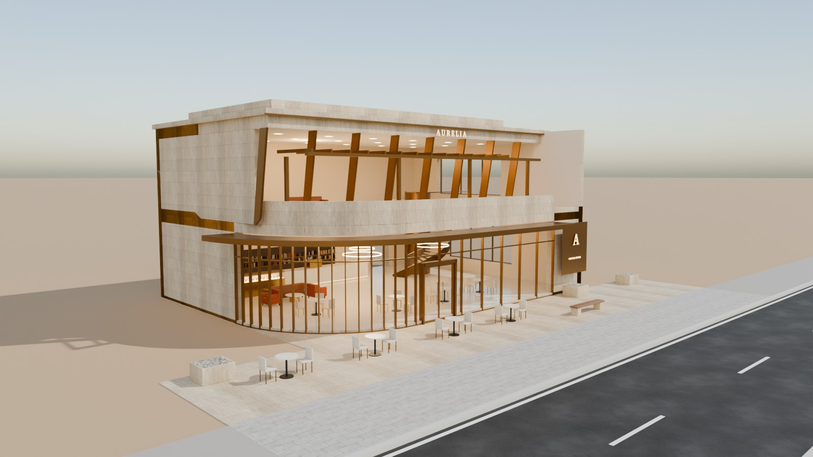
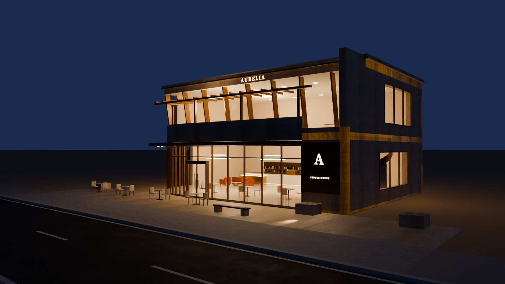
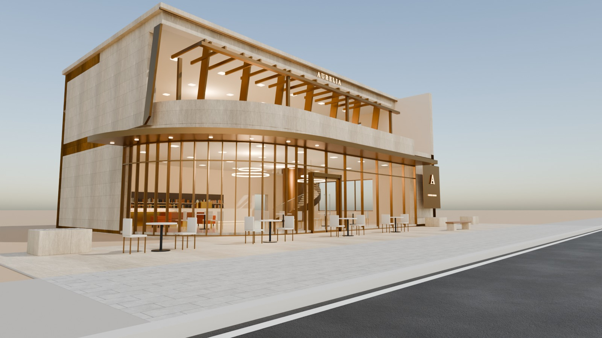
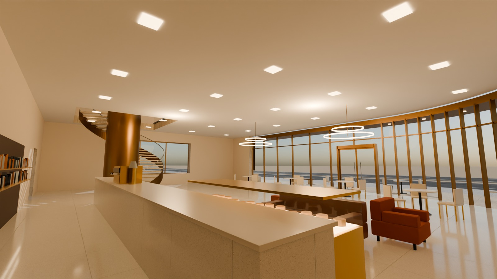

# 17 - Aurelia Coffee House

*F - Two-storey luxury cafe* - status: **incomplete**

Massing: warm travertine-clad volume whose front-LEFT corner is a 6 m radius CURVED glass wall (ground floor) under a curved bronze canopy that follows it.  The upper floor is SET BACK 4 m, leaving a roof terrace with a bronze pergola over the curve; its front is a raked (angled) glazed lounge window framed by bronze fins, and a stepped stone cornice completes a stepped roof composition.  Premium roadside stone terrace with benches and EMPTY stone planters. Inside: marble + brass coffee counter, armchairs, a curved stair to an upstairs lounge with chesterfield-style sofas, brass ring chandeliers. Site: terrace directly on the pavement; no parking.

## Previews






## Key facts

| Item | Value |
|---|---|
| Storeys | 2 (floor levels [0.15, 4.8] m, roof stepped: terrace 4.8 m, upper roof 9.8 m, crown 10.5 m) |
| Frontage x depth x height | 20.0 x 15.0 x 10.5 m |
| LOD0 bounds (Blender) | [21.82, 16.6, 10.8] m |
| Setback from plot frontage | 5.0 m |
| Parking | none (roadside stone terrace) |
| Vehicle access | pedestrian only |
| Glass | curved GF PC_GlassClear corner + raked upper lounge glass |
| Lights | {'INTERIOR_LIGHTING': 3, 'EXTERIOR_LIGHTING': 2} |
| Collision boxes | 2 |

## Files

- `aurelia_coffee_house.blend` - full editable Blender 4.5.15 LTS scene (textures referenced relatively from `textures/`).
- `aurelia_coffee_house.glb` - presentation export: LOD0/1/2 + site pieces + placeholder cars + lights + collision, textures embedded.
- (no placeholder cars in this asset, so the main GLB is already building-only)
- `lod/` - geometry-only per-LOD GLBs used for independent triangle read-back (+ placeholder cars GLB where present), `build_stats.json`.
- `textures/` - procedural PBR maps (JPEG albedo/ORM/normal) + PNG brand/screen graphics.
- `renders/` - four 1600x900 Cycles JPEGs + `render_report.json` (ray-traced visibility checks).
- `validation.json` - fresh-process validation results.

## Triangles (read from the exported GLB)

| LOD0 | LOD1 | LOD2 | Placeholder cars | Site pieces | Collision |
|---|---|---|---|---|---|
| 26586 | 7415 | 954 | 0 | 3326 | 24 |

LOD visibility ranges (glTF extras, applied by `../premium_lod_post_import.gd`): {'LOD0': [0.0, 90.0], 'LOD1': [90.0, 260.0], 'LOD2': [260.0, 1600.0]}; placeholder cars 0-340 m.

## Hierarchy

```
P17_<Title> (root, origin = centre of the plot frontage line, ground; front = -Y Blender / +Z glTF)
  LOD0/1/2 -> BUILDING_EXTERIOR, BUILDING_INTERIOR, GLASS_SYSTEM, FACADE_DETAILS, SIGNAGE, FURNITURE, DISPLAY_OBJECTS
  SIDEWALK_FRONTAGE, OPTIONAL_FORECOURT, DRIVEWAY, OPTIONAL_PARKING   (separate, removable site pieces)
  PLACEHOLDER_CARS (one object per car)   INTERIOR_LIGHTING   EXTERIOR_LIGHTING   COLLISION (*-convcolonly)
```

## Validation

- Result: **PASS**; issues: []; warnings: []
- Degenerate faces: 0; inverted faces in watertight pieces: 0; vegetation: none
- Glass materials: {'PC_GlassBlue': {'alpha': 0.3, 'blend': 'BLEND', 'double_sided': True}, 'PC_GlassClear': {'alpha': 0.11, 'blend': 'BLEND', 'double_sided': True}, 'PC_GlassRail': {'alpha': 0.14, 'blend': 'BLEND', 'double_sided': True}, 'PC_GlassSatin': {'alpha': 0.55, 'blend': 'BLEND', 'double_sided': True}}
- GLB re-import into a clean scene: {'mesh_objects': 64, 'triangles': 38305, 'glb_triangles': 38305, 'images_loaded': 18, 'lights': 5, 'lod0_size_yup_converted': [21.82, 16.6, 10.8]}

Brand note: Original fictional brand.

Godot import has NOT been tested from the cloud session. If you copy this folder into a Godot project, delete or exclude the `.blend` (Godot would try to import it) - `textures/` and `renders/` contain `.gdignore`.
